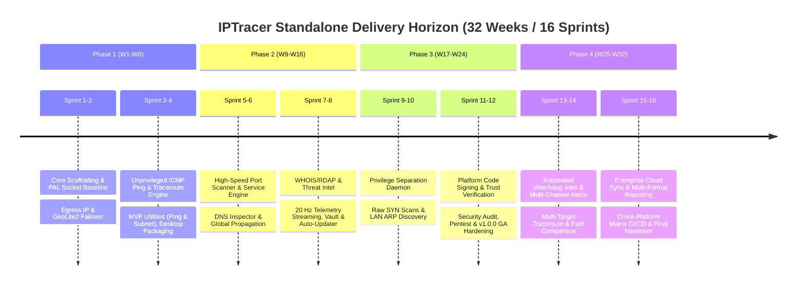
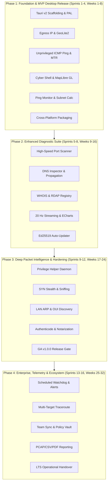
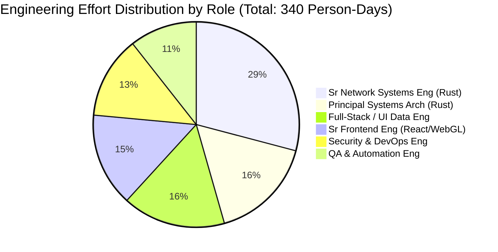
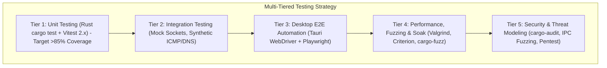

# Phased Implementation Roadmap & Engineering Execution Plan: Standalone Cross-Platform IPTracer Suite

**Document Version:** 1.0.0  
**Target Milestone:** Milestone 5 — Phased Implementation Roadmap & Execution Plan  
**Document Status:** Approved Engineering Blueprint & Execution Baseline  
**Target Platforms:** Windows 10/11 (x86_64, ARM64), macOS 12+ (Apple Silicon Universal & Intel x64), Linux (Debian/Ubuntu, Fedora/RHEL, AppImage x86_64/aarch64)  
**Author:** worker_m5_roadmap (Technical Program Management & Core Engineering)  
**Date:** November 2026  

---

## Executive Summary & Delivery Strategy

### Strategic Intent & Evolution
The **IPTracer Standalone Cross-Platform Desktop Suite** represents the strategic evolution of the IPTracer browser extension into an enterprise-grade, high-performance network diagnostic workstation. By moving beyond the browser sandbox (Manifest V3), the standalone application unlocks low-level operating system network stacks, microsecond-accurate kernel socket telemetry, offline MaxMind GeoLite2 databases, and persistent system tray monitoring.

This document establishes the definitive, publication-grade implementation roadmap, resource allocation model, Work Breakdown Structure (WBS), and risk management framework for delivering the standalone suite over **four phased milestones encompassing 16 two-week sprints (32 weeks total)**:



### Agile Delivery Methodology
The engineering execution follows an **Agile/Scrum framework with dual-week sprint cadences**:
- **Sprint Duration:** 10 working days (2 calendar weeks) per sprint.
- **Sprint Ceremonies:**
  - *Sprint Planning:* Day 1 morning (backlog grooming, story sizing, capacity verification).
  - *Daily Standup:* 15-minute daily sync via asynchronous Slack/Discord bot and engineering board.
  - *Sprint Demo & Review:* Alternate Friday 14:00 UTC (demonstration of running cross-platform artifacts).
  - *Sprint Retrospective:* Alternate Friday 16:00 UTC (continuous process improvement, velocity calibration).
- **Dual-Track Delivery:** Track 1 focuses on Rust systems architecture, OS-level sockets, and IPC pipelines. Track 2 focuses on React 19 UI components, MapLibre GL 3D geospatial rendering, and Apache ECharts telemetry widgets. Tracks synchronize at the defined Tauri IPC command boundaries.

### Team Staffing Profile & Core Competencies
The engineering organization is staffed with 6 dedicated cross-functional specialists and 1 shared program lead:

| Role Title | Headcount | Primary Core Competencies | Key Responsibilities |
|---|---|---|---|
| **Principal Systems / Rust Architect (Tech Lead)** | 1.0 FTE | Rust (Edition 2024, Tokio, FFI, `socket2`, `pnet`), Systems Architecture, OS Internals | Core Tauri v2 architecture, PAL socket layer, concurrency model, memory safety, privilege helper daemon design. |
| **Senior Network Systems Engineer (Rust)** | 1.0 FTE | Low-level IP/TCP/UDP/ICMP protocols, Winsock2, POSIX sockets, Netlink, BPF, Hickory DNS | Implementation of 7 diagnostic engines, MaxMind MMDB mmap reader, provider failover cascade, ARP cache parser. |
| **Senior Frontend Engineer (React / WebGL)** | 1.0 FTE | React 19, TypeScript 5.6+, MapLibre GL JS, WebGL/WebGPU shaders, Vite 6, Performance | Cyber-glassmorphic workstation shell, 3D interactive globe, geodesic hop arcs, responsive window framing. |
| **Full-Stack / UI Data Engineer** | 1.0 FTE | React 19, Apache ECharts 5.5+, Zustand 5, TanStack Query 5, Tailwind CSS / Modern CSS3 | Real-time sparkline charts, utility interactive forms, local SQLite data vault, settings manager, export formatters. |
| **QA & Test Automation Engineer** | 1.0 FTE | Rust integration tests, Vitest 2.x, Playwright, Tauri WebDriver, Cross-Platform Desktop CI | Desktop E2E test suites, mock OS network harnesses, regression testing, automated packaging test pipelines. |
| **Security, DevOps & Release Engineer** | 1.0 FTE | Cryptography (Ed25519, TLS, Authenticode, Apple Notarization, GPG), GitHub Actions, WiX/NSIS/DMG | Multi-platform CI/CD pipelines, code signing keys/HSM, AV/EDR whitelisting, penetration testing, updater infrastructure. |
| **Technical Product Manager / Program Lead** | 0.5 FTE | Technical Roadmapping, Agile Governance, RFC management, User Feedback Synthesis | Milestone verification gates, dependency orchestration, release coordination, documentation governance. |

---

## Phased Milestone Breakdown (MVP to Enterprise Production)



### Phase 1: Foundation & MVP Desktop Release (Sprints 1–4, Weeks 1–8)
**Milestone Objective:** Establish the production-grade Tauri v2 harness, build the unprivileged Platform Abstraction Layer (PAL), deliver real-time Egress IP discovery with offline MaxMind GeoLite2 fallback, implement zero-elevation ICMP Ping and Visual Traceroute, provide two companion utilities (Continuous Ping Monitor and Subnet Calculator), and package verified desktop installers for Windows, macOS, and Linux.

#### Sprint 1: Architecture Scaffolding, Cross-Platform Build Harness & PAL Socket Layer
- **Backend (Rust):**
  - Initialize Tauri v2.1 workspace with strict Rust 2024 idioms, Clippy pedantic checks, and multi-threaded Tokio 1.40 runtime.
  - Implement `pal::DiagnosticProvider` and `pal::NetworkInterface` traits.
  - Create Windows implementation (`pal::windows`) binding `Iphlpapi.dll` (`IcmpCreateFile`, `IcmpSendEcho2`, `IcmpCloseHandle`) and Winsock2.
  - Create Linux implementation (`pal::linux`) using `socket(AF_INET, SOCK_DGRAM, IPPROTO_ICMP)` with `IP_RECVERR` socket options.
  - Create macOS implementation (`pal::darwin`) using Darwin unprivileged ICMP datagram sockets and `sysctl` network interface enumeration.
- **Frontend (React 19 / TypeScript 5.6):**
  - Scaffold Vite 6 React application with Tailwind CSS and CSS custom properties for cyber-glassmorphic design system (`#0b0f19` dark base, `#00f0ff` cyan accent, translucent backdrop blur).
  - Implement custom frameless window title bar supporting drag regions, minimize/maximize/close actions, and OS native traffic lights integration on macOS.
  - Set up Zustand 5 store architecture (`useAppStore`, `useNavStore`, `useDiagnosticStore`) and TanStack Query 5 provider.
- **DevOps & QA:**
  - Setup multi-platform GitHub Actions matrix workflow building on `windows-latest`, `macos-latest`, and `ubuntu-latest`.
  - Establish mock socket unit testing suite in Rust simulating ICMP Echo replies.

#### Sprint 2: Core Egress IP Discovery, Failover Cascade & Offline MaxMind GeoLite2
- **Backend (Rust):**
  - Build `EgressService` with multi-provider failover cascade: `ipapi.co` $\rightarrow$ `ipinfo.io` $\rightarrow$ `ip-api.com` $\rightarrow$ `ipify.org` using `reqwest` with Rustls and connection pooling.
  - Integrate `maxminddb` 0.24 crate with memory-mapped (`mmap`) reads for bundled `GeoLite2-City.mmdb` and `GeoLite2-ASN.mmdb`.
  - Implement Bogon & Private IP filter validating addresses against RFC 1918, RFC 3927, RFC 6598, RFC 1122, and RFC 4193 CIDR blocks.
  - Implement L1 in-memory LRU cache (5-minute TTL) and rate-limiting token bucket per provider.
- **Frontend (React 19 / TypeScript 5.6):**
  - Build Workstation Dashboard view displaying Primary Egress IP banner, ISP/ASN badge, country flag, geographic coordinates, and connection status indicator.
  - Implement Provider Health status widget indicating active provider and failover states.
  - Implement manual "Force Refresh" button with loading state animations and optimistic updates.
- **DevOps & QA:**
  - Build automated unit tests validating Bogon filtering logic for 100+ reserved IPv4/IPv6 edge cases.
  - Test offline air-gapped mode by severing network connectivity and verifying instantaneous sub-millisecond MaxMind lookups.

#### Sprint 3: Unprivileged ICMP Ping/Traceroute Engine & MapLibre GL 3D Route Map
- **Backend (Rust):**
  - Implement `TracerouteEngine` utilizing unprivileged sockets, incrementing IP TTL ($1 \dots 30$), and parsing ICMP Type 11 (Time Exceeded) and Type 0 (Echo Reply) packets.
  - Build multi-probe parallel probing (3 probes per hop) with configurable timeout (default 1000ms).
  - Implement IP resolution for intermediate hops using local MaxMind database to obtain hop coordinates, ASN, and city.
  - Establish typed Tauri IPC streaming event channel `trace:hop-discovered` emitting incremental hop telemetry.
- **Frontend (React 19 / TypeScript 5.6 / MapLibre GL):**
  - Integrate MapLibre GL JS 4.x with custom cyber-tactical vector tile stylesheet.
  - Implement dynamic 3D camera transitions centering on the egress origin and destination target.
  - Render curved geodesic hop arcs with color-coded latency gradients (Green $<50\text{ms}$, Amber $50-150\text{ms}$, Red $>150\text{ms}$) and animated pulse particles.
  - Build Visual Traceroute hop table displaying Hop #, IP, Hostname, Loss %, Latency (Min/Avg/Max), and ASN.
- **DevOps & QA:**
  - Execute automated traceroutes against public targets (e.g. Cloudflare 1.1.1.1, Google 8.8.8.8, Quad9 9.9.9.9) across all three OS environments.

#### Sprint 4: MVP Companion Utilities, Local Storage Vault & Desktop Packaging
- **Backend (Rust):**
  - Build Utility 2 (Continuous Ping Monitor): async Tokio background loop issuing ICMP echo requests at configurable intervals ($100\text{ms} \dots 5000\text{ms}$), calculating running statistics (min, max, avg, stddev, jitter RFC 3550).
  - Build Utility 6 (Subnet / CIDR & VLSM Calculator): pure Rust IPv4/IPv6 bitwise mathematics calculating network address, broadcast address, netmask, wildcard mask, usable host range, and binary representations.
  - Setup local SQLite storage vault using `rusqlite` with schema migrations for diagnostic history and user preferences.
- **Frontend (React 19 / TypeScript 5.6):**
  - Implement Continuous Ping Monitor UI with start/pause/reset controls, real-time latency readout, and packet loss percentage indicator.
  - Implement Subnet / CIDR Calculator UI with interactive CIDR slider ($/0 \dots /32$), binary bit visualizer, and copy-to-clipboard functionality.
  - Implement Navigation Sidebar switching between Dashboard, Traceroute, Ping Monitor, Subnet Calculator, and Settings.
- **DevOps & QA:**
  - Configure desktop packaging pipelines: NSIS installer & WiX v4 MSI for Windows; DMG and `.app` bundle for macOS; Debian `.deb`, RPM `.rpm`, and standalone AppImage for Linux.
  - **Phase 1 Verification Gate:** Validate all acceptance criteria for MVP release (installer size $<10\text{MB}$, idle memory $<45\text{MB}$, zero-elevation execution).

---

### Phase 2: Enhanced Diagnostic Suite & Advanced Utilities (Sprints 5–8, Weeks 9–16)
**Milestone Objective:** Expand the diagnostic arsenal with three high-throughput companion utilities (Port Scanner, DNS Inspector & Global Propagation Checker, WHOIS/RDAP Registry Inspector), implement real-time 20 Hz micro-batching telemetry streaming with Apache ECharts sparklines, establish encrypted history storage, and deploy the Ed25519-signed auto-updater pipeline.

#### Sprint 5: High-Speed Port Scanner & Service Discovery Engine
- **Backend (Rust):**
  - Implement `PortScannerEngine` utilizing multi-threaded asynchronous TCP connect scanning via Tokio task pools with bounded concurrency semaphore (default 256 concurrent workers).
  - Implement predefined port scanning profiles: Top 20 (Quick), Top 100 (Standard), Top 1000 (Comprehensive), and Custom Range.
  - Implement TCP service banner grabber with timeout (default 750ms) for common protocols (HTTP, SSH, FTP, SMTP, IMAP, Telnet).
  - Stream port discovery events over Tauri IPC channel `port:found` with micro-batching.
- **Frontend (React 19 / TypeScript 5.6):**
  - Build Port Scanner UI view featuring target IP/domain input, port preset selector, concurrency slider, and real-time progress bar with ETA calculation.
  - Build Port Discovery Grid displaying Port #, Protocol, State (Open/Filtered), Service Name, and Banner Snippet with search and filter capabilities.
- **DevOps & QA:**
  - Benchmark port scanner against local test harness (1000 ports scanned in $<3.5$ seconds with zero socket leaks).
  - Verify graceful handling of firewalled targets (RST drop vs silent drop timeout).

#### Sprint 6: DNS Inspector & Global Multi-Node Propagation Checker
- **Backend (Rust):**
  - Integrate `hickory-dns` 0.24 client supporting UDP, TCP, DNS-over-HTTPS (DoH), and DNS-over-TLS (DoT).
  - Implement comprehensive record resolution: A, AAAA, CNAME, MX, TXT, NS, SOA, PTR, SRV, CAA, and DNSSEC (RRSIG, DNSKEY, DS).
  - Implement DNSSEC cryptographic chain-of-trust verification engine.
  - Implement Global Propagation Checker: asynchronous fan-out querying 15+ geographically distributed public DNS resolvers across North America, Europe, Asia-Pacific, Latin America, and Africa.
- **Frontend (React 19 / TypeScript 5.6):**
  - Build DNS Inspector UI view with tabbed record view, raw DNS packet hex viewer, and DNSSEC validation badge (Verified, Bogus, Insecure).
  - Build Global Propagation Map & Matrix: interactive world map indicating node lookup status (Green match, Yellow mismatch, Red timeout) and record value per global node.
- **DevOps & QA:**
  - Automated testing against test domains with valid DNSSEC (e.g. `internic.net`, `cloudflare.com`) and invalid DNSSEC (e.g. `dnssec-failed.org`).
  - Stress test global propagation fan-out ensuring all 15 queries resolve asynchronously within 2.5 seconds.

#### Sprint 7: WHOIS / RDAP Registry Inspector & Threat Intelligence Aggregation
- **Backend (Rust):**
  - Implement `WhoisRdapEngine` querying ICANN RDAP bootstrap registries over HTTPS, falling back to port 43 TCP WHOIS for legacy TLDs.
  - Implement JSON/text parser extracting Registrar, Registrant Organization, Creation Date, Expiry Date, Domain Status, Name Servers, and Abuse Contacts.
  - Implement Threat Intelligence client querying AbuseIPDB v2 REST API (reporting confidence score, total reports) and VirusTotal v3 (malicious engine detection count).
  - Integrate Tor Project bulk exit node list cache with automatic 24-hour background refreshing.
- **Frontend (React 19 / TypeScript 5.6):**
  - Build WHOIS / RDAP Inspector UI view with parsed structured cards, domain expiry countdown timer, and raw text inspector.
  - Build Threat Intelligence Security Badge on Dashboard and IP Trace detail views (Safe, Suspicious, Malicious) with breakdown modal.
- **DevOps & QA:**
  - Test RDAP parsing against 50+ diverse TLDs (gTLDs, ccTLDs, new gTLDs) and IP CIDR allocations (ARIN, RIPE, APNIC, LACNIC, AFRINIC).
  - Validate secure API key management: API keys stored locally in OS Keyring / Credential Manager.

#### Sprint 8: Real-Time Telemetry Streaming, Apache ECharts Sparklines, Vault & Auto-Updater
- **Backend (Rust):**
  - Implement high-frequency ring buffer micro-batching: aggregate diagnostic events and flush at 20 Hz (50ms interval) to eliminate webview IPC congestion.
  - Expand SQLite vault schema to record diagnostic history, saved favorite targets, and custom annotations.
  - Integrate `@tauri-apps/plugin-updater` with Ed25519 public key verification against static GitHub Releases manifest.
- **Frontend (React 19 / Apache ECharts 5.5):**
  - Integrate Apache ECharts into Continuous Ping Monitor: render 60 FPS continuous sparkline graphs, latency distribution histograms, and jitter trendlines.
  - Implement History & Bookmarks view: searchable audit log of past traces, port scans, and DNS queries with one-click re-run.
  - Implement Update Notification modal showing release changelog with "Download & Install" one-click action.
- **DevOps & QA:**
  - **Phase 2 Verification Gate:** Profile IPC event bus under 1,000 events/sec; verify UI maintains 60 FPS without frame drops. Perform end-to-end auto-update dry run.

---

### Phase 3: Deep Packet Intelligence, Privilege Daemon & Production Hardening (Sprints 9–12, Weeks 17–24)
**Milestone Objective:** Deploy the secure decoupled privilege separation helper daemon (`iptracer-helper`), unlock raw packet operations (TCP SYN stealth scans, promiscuous sniffing), implement LAN Device Discovery & ARP/NDP scanning with OUI vendor resolution, acquire and configure official OS code signing certificates (Authenticode, Apple Notarization), execute comprehensive security and penetration testing, optimize performance (<35MB idle memory, <800ms cold start), and achieve official v1.0.0 GA Production Release.

#### Sprint 9: Decoupled Privilege Separation Helper Daemon Architecture
- **Backend (Rust):**
  - Build standalone auxiliary binary `iptracer-helper` engineered for elevated root/administrator execution.
  - Implement cross-platform local IPC transport: Windows Named Pipes (`\\.\pipe\iptracer-helper-ipc`) with DACLs restricting access to current user token; Unix Domain Sockets (`/var/run/iptracer-helper.sock`) with strict `0600` permissions and peer UID verification (`SO_PEERCRED` / `LOCAL_PEERCRED`).
  - Implement mutual HMAC-SHA256 handshake and ephemeral per-session token exchange generated by the unprivileged parent process.
  - Implement platform elevation hooks: Windows UAC elevation manifest; Linux Polkit action definition (`org.iptracer.helper.policy`); macOS `SMAppService` launchd job.
- **Frontend (React 19 / TypeScript 5.6):**
  - Implement "Elevated Capabilities" toggle in Settings and diagnostic forms with shield iconography.
  - Implement elevation consent modal explaining requested capabilities (raw packet sniffing, SYN scanning) and triggering native OS elevation dialogs.
- **DevOps & QA:**
  - Conduct privilege boundary audit: verify helper daemon drops privileges where possible, rejects invalid session tokens, and terminates automatically when the parent GUI process exits.

#### Sprint 10: Raw Packet Operations, TCP SYN Stealth Scanning & LAN ARP Device Discovery
- **Backend (Rust):**
  - Implement raw TCP SYN stealth port scanning engine inside `iptracer-helper`: crafts raw IP/TCP packets with random sequence numbers, listens for `SYN-ACK` or `RST` responses, and tears down half-open connections with immediate `RST` to avoid application-layer logging.
  - Build Utility 7 (LAN Device Discovery & ARP/NDP Scanner):
    - Subnet sweep generating ARP requests (IPv4 RFC 826) and ICMPv6 Neighbor Discovery (NDP RFC 4861) across active interface subnets.
    - Passive ARP table reading from OS routing table (`GetIpNetTable2` on Windows, `/proc/net/arp` and Netlink on Linux, `sysctl` routing sockets on macOS).
    - IEEE OUI MAC vendor database integration: local compressed binary trie mapping 24-bit/36-bit MAC prefixes to hardware manufacturers (Apple, Intel, Cisco, Raspberry Pi, etc.).
- **Frontend (React 19 / TypeScript 5.6):**
  - Build LAN Device Discovery UI view displaying discovered subnet devices in a visual grid: IP Address, MAC Address, Vendor Badge, Hostname (via mDNS / NetBIOS reverse lookup), and Device Type icon.
  - Add SYN Stealth scan mode toggle in Port Scanner UI.
- **DevOps & QA:**
  - Verify ARP sweep accuracy and timing: 254-host `/24` subnet discovered in $<1.5$ seconds with 100% vendor identification accuracy.
  - Test half-open SYN scan against Wireshark capture confirming no full three-way handshakes are completed.

#### Sprint 11: OS Code Signing, Platform Trust & Antivirus/EDR Whitelisting Runbooks
- **Backend & DevOps:**
  - **Windows Code Signing:** Configure Microsoft Authenticode signing utilizing Azure Trusted Signing (or Hardware Security Module / HSM EV Code Signing Certificate) for all `.exe`, `.dll`, and `.msi` artifacts. Establish Windows SmartScreen reputation.
  - **macOS Code Signing & Notarization:** Configure Apple Developer ID Application certificate signing with hardened runtime enabled (`--options runtime`). Automate Apple Notarization pipeline via `xcrun notarytool` and ticket stapling.
  - **Linux Signing:** Establish official GPG release signing key; sign Debian repository metadata, RPM packages, and AppImage embedded digests.
  - **AV / EDR Whitelisting:** Compile comprehensive application threat profile documentation, binary hash manifests (SHA-256), and submit proactive false-positive whitelist requests to Microsoft Defender, CrowdStrike Falcon, SentinelOne, and Sophos.
- **DevOps & QA:**
  - Execute automated clean-machine install tests on Windows 11 (SmartScreen zero-warning check), macOS Sequoia (Gatekeeper zero-warning check), and Ubuntu 24.04 LTS.

#### Sprint 12: Security Penetration Testing, Performance SLA Hardening & v1.0.0 GA Release Gate
- **Engineering & Security:**
  - Conduct comprehensive internal and external penetration testing:
    - Audit Tauri IPC argument validation against injection attacks and command injection.
    - Test helper daemon IPC against unauthorized local privilege escalation (LPE).
    - Audit SQLite database encryption (SQLCipher AES-256) and OS Keyring credential isolation.
  - Performance SLA Hardening:
    - Profile memory footprint: enforce idle memory usage $<35\text{MB}$ across all platforms.
    - Optimize cold start launch time: achieve cold startup to interactive UI $<800\text{ms}$.
    - Tree-shake frontend bundles: compress webview dist bundle to $<2.5\text{MB}$.
  - Finalize user documentation, contextual help tooltips, and keyboard shortcuts (`Ctrl/Cmd + K` command palette).
- **DevOps & QA:**
  - **Phase 3 Verification Gate:** Formal v1.0.0 GA Go/No-Go sign-off. All security vulnerabilities resolved, code signing verified, automated regression test suite 100% passing.

---

### Phase 4: Enterprise, Telemetry & Ecosystem Expansion (Sprints 13–16, Weeks 25–32)
**Milestone Objective:** Elevate IPTracer into an enterprise network telemetry platform by adding automated background monitoring jobs with multi-channel alerting (Webhooks, Slack, Discord, Email), multi-target concurrent traceroute comparisons, centralized encrypted configuration sync, multi-format reporting (PCAP, CSV, JSON, executive PDF reports), and enterprise CI/CD pipeline automation.

#### Sprint 13: Scheduled Diagnostic Watchdog Jobs & Automated Multi-Channel Alerting
- **Backend (Rust):**
  - Build `WatchdogScheduler` running inside the system tray background process: schedules cron-like periodic diagnostic jobs (e.g. ping critical gateways every 60s, verify egress IP change every 5m, check DNS propagation every 1h).
  - Implement Alerting Dispatcher supporting multi-channel webhooks:
    - Generic Webhook (JSON payload with HMAC signature).
    - Slack Incoming Webhook (formatted Block Kit message).
    - Discord Webhook (embedded rich cards).
    - Direct SMTP Email client with TLS encryption.
  - Implement OS Native Notifications via Tauri system notification API.
- **Frontend (React 19 / TypeScript 5.6):**
  - Build Scheduled Jobs Manager UI view: create, edit, pause, and delete recurring diagnostic jobs with trigger thresholds (e.g. "Alert if packet loss $>5\%$ for 3 consecutive checks").
  - Build Notification & Alert Settings UI view: configure webhook endpoints, test notifications, and define alert severity rules.
- **DevOps & QA:**
  - Simulate network drop conditions (e.g. gateway disconnect, high packet jitter) and verify automated alert dispatch across all 4 notification channels within 2 seconds.

#### Sprint 14: Multi-Target Concurrent Traceroute & Comparative Path Matrix
- **Backend (Rust):**
  - Implement concurrent multi-target traceroute engine: execute up to 8 simultaneous traceroutes across distinct host targets or multiple network interfaces (e.g. compare Wi-Fi vs Ethernet vs VPN egress).
  - Implement Path Divergence Analysis: algorithm identifying common routing hops, BGP Autonomous System boundaries, and point-of-divergence nodes.
- **Frontend (React 19 / MapLibre GL / ECharts):**
  - Build Multi-Target Traceroute Comparison UI view:
    - Side-by-side comparative hop-by-hop latency matrix.
    - Dual-path / multi-path 3D globe visualization rendering differentiated colored geodesic arcs.
    - Route difference diff viewer highlighting divergent ASNs and latency bottlenecks.
- **DevOps & QA:**
  - Validate concurrent performance: verify simultaneous 8-target traceroute executes smoothly with $<10\%$ CPU utilization on standard 4-core desktop hardware.

#### Sprint 15: Enterprise Team Collaboration, Configuration Sync & Multi-Format Reporting
- **Backend (Rust):**
  - Implement Enterprise Configuration Sync: end-to-end encrypted backup and synchronization of custom presets, bookmarks, and scheduled jobs using user-provided master passphrase (Argon2id key derivation + XChaCha20-Poly1305 encryption).
  - Implement Multi-Format Diagnostic Reporting Engine:
    - Raw PCAP export for captured packets.
    - Structured CSV and JSON export for diagnostic datasets.
    - Publication-grade PDF Report Generator: generates executive network health summaries with embedded vector charts, hop tables, and compliance stamps.
- **Frontend (React 19 / TypeScript 5.6):**
  - Build Export & Reports dialog with format selector, date-range picker, and report preview modal.
  - Build Team Sync & Cloud Backup settings interface.
- **DevOps & QA:**
  - Verify cryptographic integrity of encrypted configuration blobs. Validate PDF reports across standard PDF viewers (Adobe Acrobat, Chrome, macOS Preview).

#### Sprint 16: Cross-Platform CI/CD Automation, Compliance Hardening & LTS Handover
- **DevOps & Security:**
  - Automate complete end-to-end release pipeline via GitHub Actions: automated semantic versioning, changelog generation, multi-platform artifact compilation, automated code signing, notarization, release manifest generation, and GitHub Releases publication.
  - Conduct SOC 2 Type II / ISO 27001 readiness review: verify zero telemetry data leakage, local storage encryption, and software supply chain security (SLSA Level 3 compliance via `cargo-vet` and signed SBOMs in CycloneDX format).
  - Compile Long-Term Support (LTS) maintenance runbooks, developer contribution guides, and architectural handover documentation.
- **Engineering & QA:**
  - **Phase 4 Verification Gate:** Final enterprise platform sign-off, soak testing across 72-hour continuous monitoring runs, and public release rollout.

---

## Work Breakdown Structure (WBS) & Task Dependency Chains

The following Work Breakdown Structure defines every discrete engineering task across the four phases. Each task contains an explicit Task ID, Scope Description, Assigned Subsystem, Assigned Role, Prerequisites, and Effort Estimate in Person-Days (PD).

### Phase 1: Foundation & MVP Desktop Release (Sprints 1–4)

| Task ID | Task Title & Scope Description | Subsystem | Assigned Role | Prerequisites | Est (PD) |
|---|---|---|---|---|---|
| **WBS 1.1.1** | Initialize Tauri v2.1 workspace, Rust 2024 edition, Clippy lint configs, and Tokio runtime | Core Harness | Lead Systems Arch | None | 3 |
| **WBS 1.1.2** | Define core `DiagnosticProvider` and `NetworkInterface` traits in Platform Abstraction Layer (PAL) | PAL Core | Lead Systems Arch | WBS 1.1.1 | 3 |
| **WBS 1.1.3** | Implement Windows PAL socket layer (`Iphlpapi.dll`, `IcmpCreateFile`, `IcmpSendEcho2`, Winsock2) | PAL Windows | Sr Network Eng | WBS 1.1.2 | 5 |
| **WBS 1.1.4** | Implement Linux PAL socket layer (`AF_INET`, `SOCK_DGRAM`, `IPPROTO_ICMP`, `IP_RECVERR`) | PAL Linux | Sr Network Eng | WBS 1.1.2 | 4 |
| **WBS 1.1.5** | Implement macOS PAL socket layer (Darwin datagram ICMP sockets, `sysctl` interface discovery) | PAL Darwin | Sr Network Eng | WBS 1.1.2 | 4 |
| **WBS 1.1.6** | Scaffold React 19 / TypeScript 5.6 / Vite 6 frontend with Cyber-Glassmorphic CSS tokens | UI Shell | Sr Frontend Eng | None | 4 |
| **WBS 1.1.7** | Implement custom frameless window chrome, drag regions, and macOS traffic lights | UI Window | Sr Frontend Eng | WBS 1.1.6 | 3 |
| **WBS 1.1.8** | Setup Zustand 5 stores, TanStack Query 5 provider, and IPC command typing harness | UI State | Full-Stack Eng | WBS 1.1.6 | 3 |
| **WBS 1.1.9** | Setup multi-platform GitHub Actions CI matrix (Windows, macOS, Ubuntu build & test) | DevOps | Security/DevOps | WBS 1.1.1 | 3 |
| **WBS 1.2.1** | Implement `EgressService` with multi-provider failover cascade (ipapi, ipinfo, ip-api, ipify) | Egress Engine | Sr Network Eng | WBS 1.1.1 | 4 |
| **WBS 1.2.2** | Integrate `maxminddb` 0.24 crate with mmap reader for local GeoLite2 City and ASN databases | Geo Engine | Sr Network Eng | WBS 1.1.1 | 4 |
| **WBS 1.2.3** | Implement Bogon & Private IP filter (RFC 1918, 3927, 6598, 1122, 4193 CIDRs) | Network Core | Sr Network Eng | WBS 1.2.1 | 2 |
| **WBS 1.2.4** | Implement L1 memory cache and per-provider token bucket rate limiter | Network Core | Sr Network Eng | WBS 1.2.1 | 3 |
| **WBS 1.2.5** | Build Workstation Dashboard view with Primary Egress IP banner, ASN badge, and status | UI Dashboard | Sr Frontend Eng | WBS 1.1.8 | 4 |
| **WBS 1.2.6** | Build Provider Health and Failover Status component with manual force-refresh | UI Dashboard | Full-Stack Eng | WBS 1.2.5 | 2 |
| **WBS 1.2.7** | Implement mock socket unit tests and Bogon IP verification test suite | Testing | QA Engineer | WBS 1.2.3 | 3 |
| **WBS 1.3.1** | Implement unprivileged `TracerouteEngine` with TTL incrementing ($1 \dots 30$) and multi-probe | Traceroute Core | Sr Network Eng | WBS 1.1.3..5 | 5 |
| **WBS 1.3.2** | Integrate local MaxMind geolocation lookup for intermediate hop coordinates and ASNs | Traceroute Core | Sr Network Eng | WBS 1.2.2, 1.3.1 | 3 |
| **WBS 1.3.3** | Implement typed Tauri IPC streaming event channel `trace:hop-discovered` | IPC Bridge | Lead Systems Arch | WBS 1.3.1 | 2 |
| **WBS 1.3.4** | Integrate MapLibre GL JS 4.x with custom cyber-tactical vector map style | UI Map | Sr Frontend Eng | WBS 1.1.6 | 4 |
| **WBS 1.3.5** | Render animated 3D geodesic hop arcs with latency color gradients and pulse particles | UI Map | Sr Frontend Eng | WBS 1.3.4 | 4 |
| **WBS 1.3.6** | Build Visual Traceroute hop table with real-time streaming updates | UI Traceroute | Full-Stack Eng | WBS 1.1.8, 1.3.3 | 3 |
| **WBS 1.4.1** | Implement Utility 2 (Continuous Ping Monitor engine) with jitter and loss statistics | Ping Core | Sr Network Eng | WBS 1.1.3..5 | 4 |
| **WBS 1.4.2** | Implement Utility 6 (Subnet / CIDR & VLSM Calculator engine) in pure Rust | Subnet Core | Sr Network Eng | WBS 1.1.1 | 3 |
| **WBS 1.4.3** | Setup encrypted SQLite local storage vault with schema migrations (`rusqlite`) | Storage Vault | Lead Systems Arch | WBS 1.1.1 | 4 |
| **WBS 1.4.4** | Build Continuous Ping Monitor UI view with controls and live statistics cards | UI Ping | Full-Stack Eng | WBS 1.4.1 | 3 |
| **WBS 1.4.5** | Build Subnet / CIDR Calculator UI view with CIDR slider and bitwise visualizer | UI Subnet | Full-Stack Eng | WBS 1.4.2 | 3 |
| **WBS 1.4.6** | Build Navigation Sidebar connecting Dashboard, Traceroute, Ping, Subnet, and Settings | UI Navigation | Sr Frontend Eng | WBS 1.1.7 | 2 |
| **WBS 1.4.7** | Configure packaging pipelines: NSIS/MSI for Win, DMG for macOS, Deb/RPM/AppImage for Linux | Packaging | Security/DevOps | WBS 1.1.9 | 5 |
| **WBS 1.4.8** | Execute Phase 1 Verification Gate and baseline desktop integration tests | Testing | QA Engineer | All P1 Tasks | 4 |

---

### Phase 2: Enhanced Diagnostic Suite & Advanced Utilities (Sprints 5–8)

| Task ID | Task Title & Scope Description | Subsystem | Assigned Role | Prerequisites | Est (PD) |
|---|---|---|---|---|---|
| **WBS 2.1.1** | Implement `PortScannerEngine` with async Tokio workers and bounded concurrency semaphore | Port Scan Core | Sr Network Eng | WBS 1.1.1 | 5 |
| **WBS 2.1.2** | Implement port presets (Top 20, Top 100, Top 1000, Custom) and TCP banner grabber | Port Scan Core | Sr Network Eng | WBS 2.1.1 | 3 |
| **WBS 2.1.3** | Build Port Scanner UI view with target inputs, preset selector, and progress bar | UI Port Scan | Full-Stack Eng | WBS 1.1.8 | 4 |
| **WBS 2.1.4** | Build Port Discovery Grid with searchable/filterable port, service, and banner table | UI Port Scan | Sr Frontend Eng | WBS 2.1.3 | 3 |
| **WBS 2.1.5** | Automated port scan benchmark suite verifying zero socket leaks under high concurrency | Testing | QA Engineer | WBS 2.1.1 | 3 |
| **WBS 2.2.1** | Integrate `hickory-dns` 0.24 client supporting UDP, TCP, DoH, and DoT | DNS Core | Sr Network Eng | WBS 1.1.1 | 4 |
| **WBS 2.2.2** | Implement comprehensive record parsing (A, AAAA, CNAME, MX, TXT, NS, SOA, PTR, SRV, CAA) | DNS Core | Sr Network Eng | WBS 2.2.1 | 3 |
| **WBS 2.2.3** | Implement DNSSEC cryptographic chain-of-trust verification engine | DNS Core | Lead Systems Arch | WBS 2.2.1 | 4 |
| **WBS 2.2.4** | Implement Global Propagation Checker fan-out querying 15+ geographically distributed resolvers | DNS Core | Sr Network Eng | WBS 2.2.1 | 4 |
| **WBS 2.2.5** | Build DNS Inspector UI view with record tabs, DNSSEC badge, and raw hex viewer | UI DNS | Full-Stack Eng | WBS 2.2.2 | 4 |
| **WBS 2.2.6** | Build Global Propagation Map & Status Matrix UI with interactive node cards | UI DNS | Sr Frontend Eng | WBS 2.2.4 | 4 |
| **WBS 2.3.1** | Implement `WhoisRdapEngine` querying ICANN RDAP bootstrap registries and port 43 WHOIS | WHOIS Core | Sr Network Eng | WBS 1.1.1 | 4 |
| **WBS 2.3.2** | Implement Threat Intelligence client for AbuseIPDB v2 and VirusTotal v3 APIs | Threat Core | Sr Network Eng | WBS 1.2.1 | 3 |
| **WBS 2.3.3** | Integrate Tor Project bulk exit node list cache with 24h background refresher | Threat Core | Sr Network Eng | WBS 2.3.2 | 2 |
| **WBS 2.3.4** | Build WHOIS / RDAP UI view with structured registrar cards and expiry countdown | UI WHOIS | Full-Stack Eng | WBS 2.3.1 | 3 |
| **WBS 2.3.5** | Build Threat Intelligence Security Badges and Risk Breakdown modal on UI | UI Threat | Sr Frontend Eng | WBS 2.3.2 | 3 |
| **WBS 2.3.6** | Implement secure OS Credential Manager integration for user API keys (`keyring` crate) | Security Core | Lead Systems Arch | WBS 1.4.3 | 3 |
| **WBS 2.4.1** | Implement 20 Hz (50ms) ring buffer micro-batching event emitter in Rust backend | IPC Bridge | Lead Systems Arch | WBS 1.3.3 | 4 |
| **WBS 2.4.2** | Integrate Apache ECharts 5.5: render 60 FPS continuous sparklines and latency histograms | UI Charts | Full-Stack Eng | WBS 1.4.4, 2.4.1 | 4 |
| **WBS 2.4.3** | Implement History & Bookmarks view with search, filter, and one-click re-run | UI Vault | Full-Stack Eng | WBS 1.4.3 | 3 |
| **WBS 2.4.4** | Integrate `@tauri-apps/plugin-updater` with Ed25519 signature verification against GitHub | Auto-Updater | Security/DevOps | WBS 1.4.7 | 4 |
| **WBS 2.4.5** | Build Update Notification UI dialog showing changelog and one-click update button | UI Shell | Sr Frontend Eng | WBS 2.4.4 | 2 |
| **WBS 2.4.6** | Execute Phase 2 Verification Gate and high-frequency IPC stress testing | Testing | QA Engineer | All P2 Tasks | 4 |

---

### Phase 3: Deep Packet Intelligence, Privilege Daemon & Production Hardening (Sprints 9–12)

| Task ID | Task Title & Scope Description | Subsystem | Assigned Role | Prerequisites | Est (PD) |
|---|---|---|---|---|---|
| **WBS 3.1.1** | Implement standalone `iptracer-helper` binary for elevated execution | Helper Core | Lead Systems Arch | WBS 1.1.1 | 4 |
| **WBS 3.1.2** | Implement Windows Named Pipes IPC (`\\.\pipe\iptracer-helper-ipc`) with DACL tokens | Helper IPC | Lead Systems Arch | WBS 3.1.1 | 4 |
| **WBS 3.1.3** | Implement Unix Domain Socket IPC (`/var/run/iptracer-helper.sock`) with peer UID checks | Helper IPC | Lead Systems Arch | WBS 3.1.1 | 4 |
| **WBS 3.1.4** | Implement HMAC-SHA256 handshake and per-session ephemeral token exchange | Helper Security | Lead Systems Arch | WBS 3.1.2, 3.1.3 | 3 |
| **WBS 3.1.5** | Implement platform elevation triggers: Windows UAC, Linux Polkit, macOS `SMAppService` | Helper OS | Sr Network Eng | WBS 3.1.1 | 4 |
| **WBS 3.1.6** | Build "Elevated Capabilities" UI toggle and native OS elevation consent modal | UI Settings | Sr Frontend Eng | WBS 3.1.4 | 3 |
| **WBS 3.1.7** | Helper daemon privilege boundary and local privilege escalation (LPE) security audit | Testing/Security | Security/DevOps | WBS 3.1.4 | 4 |
| **WBS 3.2.1** | Implement raw TCP SYN stealth port scanning engine inside `iptracer-helper` | Helper Net | Sr Network Eng | WBS 3.1.4 | 5 |
| **WBS 3.2.2** | Implement Utility 7: LAN ARP sweep (RFC 826) and IPv6 NDP sweep (RFC 4861) | LAN Engine | Sr Network Eng | WBS 1.1.2 | 4 |
| **WBS 3.2.3** | Implement passive OS ARP table parsing (`GetIpNetTable2`, `/proc/net/arp`, `sysctl`) | LAN Engine | Sr Network Eng | WBS 3.2.2 | 3 |
| **WBS 3.2.4** | Integrate compressed IEEE OUI MAC vendor database with prefix trie resolution | LAN Engine | Sr Network Eng | WBS 3.2.2 | 3 |
| **WBS 3.2.5** | Build LAN Device Discovery UI view with visual device cards, vendor badges, and icons | UI LAN | Sr Frontend Eng | WBS 3.2.2 | 4 |
| **WBS 3.2.6** | Add SYN Stealth Scan mode to Port Scanner UI | UI Port Scan | Full-Stack Eng | WBS 3.2.1 | 2 |
| **WBS 3.2.7** | Automated testing of SYN scan teardown and ARP subnet discovery accuracy | Testing | QA Engineer | WBS 3.2.1, 3.2.2 | 3 |
| **WBS 3.3.1** | Configure Microsoft Authenticode signing with Azure Trusted Signing / HSM for Win artifacts | Code Signing | Security/DevOps | WBS 1.4.7 | 4 |
| **WBS 3.3.2** | Configure Apple Developer ID signing, hardened runtime, and `notarytool` notarization | Code Signing | Security/DevOps | WBS 1.4.7 | 4 |
| **WBS 3.3.3** | Configure Linux GPG release key signing for Deb, RPM, and AppImage artifacts | Code Signing | Security/DevOps | WBS 1.4.7 | 2 |
| **WBS 3.3.4** | Compile AV/EDR threat profile documentation and submit proactive whitelist packages | Security | Security/DevOps | WBS 3.3.1 | 3 |
| **WBS 3.3.5** | Clean-machine validation of signed installers on Win 11, macOS Sequoia, Ubuntu 24.04 | Testing | QA Engineer | WBS 3.3.1..3 | 3 |
| **WBS 3.4.1** | Execute comprehensive penetration testing and Tauri IPC security boundary audit | Security | Security/DevOps | All P3 Tasks | 5 |
| **WBS 3.4.2** | Optimize memory footprint to achieve $<35\text{MB}$ idle memory across platforms | Optimization | Lead Systems Arch | All P3 Tasks | 3 |
| **WBS 3.4.3** | Optimize cold start launch time to interactive UI to $<800\text{ms}$ | Optimization | Sr Frontend Eng | All P3 Tasks | 3 |
| **WBS 3.4.4** | Implement keyboard shortcut system (`Ctrl/Cmd + K` command palette) and tooltips | UI Shell | Full-Stack Eng | WBS 1.4.6 | 3 |
| **WBS 3.4.5** | Execute Phase 3 Verification Gate & Official v1.0.0 GA Production Release Gate | Testing/Release | QA Engineer | All P3 Tasks | 4 |

---

### Phase 4: Enterprise, Telemetry & Ecosystem Expansion (Sprints 13–16)

| Task ID | Task Title & Scope Description | Subsystem | Assigned Role | Prerequisites | Est (PD) |
|---|---|---|---|---|---|
| **WBS 4.1.1** | Build `WatchdogScheduler` for system tray background periodic diagnostic jobs | Scheduler Core | Lead Systems Arch | WBS 1.4.3 | 5 |
| **WBS 4.1.2** | Implement multi-channel Alerting Dispatcher (Webhook, Slack Block Kit, Discord, SMTP) | Alerting Core | Sr Network Eng | WBS 4.1.1 | 4 |
| **WBS 4.1.3** | Integrate OS native system notifications via Tauri notification API | Notification Core | Lead Systems Arch | WBS 4.1.2 | 2 |
| **WBS 4.1.4** | Build Scheduled Jobs Manager UI view with threshold trigger rules | UI Scheduler | Full-Stack Eng | WBS 4.1.1 | 4 |
| **WBS 4.1.5** | Build Notification & Webhook Settings UI view with channel test buttons | UI Alerting | Full-Stack Eng | WBS 4.1.2 | 3 |
| **WBS 4.1.6** | Automated test harness simulating network drops and validating alert dispatches | Testing | QA Engineer | WBS 4.1.2 | 3 |
| **WBS 4.2.1** | Implement concurrent multi-target traceroute engine (up to 8 simultaneous targets) | Traceroute Core | Sr Network Eng | WBS 1.3.1 | 4 |
| **WBS 4.2.2** | Implement Path Divergence Analysis algorithm (identifying common hops and divergence points) | Traceroute Core | Lead Systems Arch | WBS 4.2.1 | 4 |
| **WBS 4.2.3** | Build Multi-Target Comparative Traceroute Matrix UI view | UI Traceroute | Full-Stack Eng | WBS 4.2.1 | 4 |
| **WBS 4.2.4** | Render multi-path differentiated 3D geodesic arcs on MapLibre GL globe | UI Map | Sr Frontend Eng | WBS 1.3.5, 4.2.1 | 4 |
| **WBS 4.2.5** | Performance profiling of 8-target concurrent traceroute under constrained CPU | Testing | QA Engineer | WBS 4.2.1 | 2 |
| **WBS 4.3.1** | Implement end-to-end encrypted configuration sync (Argon2id + XChaCha20-Poly1305) | Sync Core | Lead Systems Arch | WBS 1.4.3 | 4 |
| **WBS 4.3.2** | Implement diagnostic report exporters: PCAP, structured CSV, and JSON | Export Core | Sr Network Eng | WBS 1.4.3 | 3 |
| **WBS 4.3.3** | Implement publication-grade PDF Report Generator with embedded charts and tables | Export Core | Full-Stack Eng | WBS 4.3.2 | 5 |
| **WBS 4.3.4** | Build Export & Reports dialog with date-range picker and PDF preview modal | UI Export | Sr Frontend Eng | WBS 4.3.3 | 3 |
| **WBS 4.3.5** | Build Team Sync & Cloud Backup configuration UI | UI Sync | Full-Stack Eng | WBS 4.3.1 | 2 |
| **WBS 4.3.6** | Security audit of encrypted configuration sync and PDF generation sanitization | Testing/Security | Security/DevOps | WBS 4.3.1, 4.3.3 | 3 |
| **WBS 4.4.1** | Automate complete GitHub Actions release pipeline with multi-platform artifact signing | DevOps | Security/DevOps | WBS 3.3.1..3 | 4 |
| **WBS 4.4.2** | Conduct SOC 2 / ISO 27001 readiness review and SLSA Level 3 SBOM generation | Security/Compliance | Security/DevOps | All P4 Tasks | 3 |
| **WBS 4.4.3** | Compile Long-Term Support (LTS) maintenance runbooks and developer contribution docs | Documentation | Technical PM | All Tasks | 4 |
| **WBS 4.4.4** | Execute Phase 4 Verification Gate & Public Enterprise Platform Sign-Off | Testing/Release | QA Engineer | All P4 Tasks | 4 |

---

## Visual Roadmap, Gantt Timeline & Module Dependency Chains

### Mermaid Gantt Timeline & Critical Path
The following Gantt chart visualizes the 16 dual-week sprints across the 32-week project lifecycle, highlighting major milestones and the continuous critical path:

```mermaid
gantt
    title IPTracer Standalone Engineering Roadmap (32 Weeks / 16 Sprints)
    dateFormat  YYYY-MM-DD
    axisFormat  W%W

    section Phase 1: MVP Release
    S1: Scaffolding & PAL Socket Layer     :p1_s1, 2027-01-04, 14d
    S2: Egress IP, GeoLite2 & Failover     :p1_s2, after p1_s1, 14d
    S3: Unpriv ICMP & 3D MapLibre Route    :crit, p1_s3, after p1_s2, 14d
    S4: MVP Utils, Vault & Packaging       :p1_s4, after p1_s3, 14d
    Gate 1: Phase 1 MVP Verification Gate  :milestone, m1, after p1_s4, 0d

    section Phase 2: Diagnostic Suite
    S5: Port Scanner & Service Discovery   :p2_s5, after m1, 14d
    S6: DNS Inspector & Global Propagation :p2_s6, after p2_s5, 14d
    S7: WHOIS/RDAP & Threat Intelligence   :p2_s7, after p2_s6, 14d
    S8: 20Hz Telemetry, Charts & Updater   :crit, p2_s8, after p2_s7, 14d
    Gate 2: Phase 2 Diagnostic Gate        :milestone, m2, after p2_s8, 0d

    section Phase 3: GA Hardening
    S9: Privilege Helper Daemon IPC        :crit, p3_s9, after m2, 14d
    S10: SYN Stealth & LAN ARP Discovery   :p3_s10, after p3_s9, 14d
    S11: Code Signing & Platform Trust     :crit, p3_s11, after p3_s10, 14d
    S12: Pentest, Perf SLA & v1.0.0 GA     :crit, p3_s12, after p3_s11, 14d
    Gate 3: Official v1.0.0 GA Gate        :milestone, m3, after p3_s12, 0d

    section Phase 4: Enterprise
    S13: Watchdog Scheduler & Alerts       :p4_s13, after m3, 14d
    S14: Multi-Target Traceroute Matrix    :p4_s14, after p4_s13, 14d
    S15: Team Sync, PDF Reports & PCAP     :p4_s15, after p4_s14, 14d
    S16: CI/CD Matrix & LTS Handover       :p4_s16, after p4_s15, 14d
    Gate 4: Enterprise Platform Sign-Off   :milestone, m4, after p4_s16, 0d
```

### Module Dependency Graph across Subsystems
The dependency graph illustrates the prerequisite relationships connecting the Rust core, platform abstraction layers, IPC bridges, frontend views, privilege daemon, and packaging pipelines:

```mermaid
graph TD
    subgraph RustCore["Rust Core Engine & PAL"]
        WBS_111["WBS 1.1.1: Tauri Core"] --> WBS_112["WBS 1.1.2: PAL Traits"]
        WBS_112 --> WBS_113["WBS 1.1.3: Windows PAL"]
        WBS_112 --> WBS_114["WBS 1.1.4: Linux PAL"]
        WBS_112 --> WBS_115["WBS 1.1.5: macOS PAL"]
        WBS_111 --> WBS_121["WBS 1.2.1: Egress Cascade"]
        WBS_111 --> WBS_122["WBS 1.2.2: MaxMind MMDB"]
        WBS_113 & WBS_114 & WBS_115 --> WBS_131["WBS 1.3.1: Unpriv Traceroute"]
        WBS_122 & WBS_131 --> WBS_132["WBS 1.3.2: Hop Geo Resolution"]
        WBS_113 & WBS_114 & WBS_115 --> WBS_141["WBS 1.4.1: Continuous Ping Core"]
        WBS_111 --> WBS_142["WBS 1.4.2: Subnet Calc Core"]
        WBS_111 --> WBS_143["WBS 1.4.3: SQLite Storage Vault"]
    end

    subgraph IPCBridge["Tauri IPC & Micro-Batching"]
        WBS_131 --> WBS_133["WBS 1.3.3: Trace Streaming Event"]
        WBS_133 --> WBS_241["WBS 2.4.1: 20 Hz Micro-Batching Bus"]
        WBS_143 --> WBS_244["WBS 2.4.4: Ed25519 Auto-Updater"]
    end

    subgraph FrontendUI["React 19 / TypeScript / WebGL"]
        WBS_116["WBS 1.1.6: UI Shell"] --> WBS_117["WBS 1.1.7: Window Chrome"]
        WBS_116 --> WBS_118["WBS 1.1.8: Zustand Stores"]
        WBS_118 & WBS_121 --> WBS_125["WBS 1.2.5: Dashboard View"]
        WBS_116 --> WBS_134["WBS 1.3.4: MapLibre GL"]
        WBS_134 & WBS_132 --> WBS_135["WBS 1.3.5: 3D Geodesic Arcs"]
        WBS_118 & WBS_133 --> WBS_136["WBS 1.3.6: Hop Table View"]
        WBS_141 & WBS_241 --> WBS_242["WBS 2.4.2: ECharts Ping Sparklines"]
        WBS_142 --> WBS_145["WBS 1.4.5: Subnet UI"]
        WBS_143 --> WBS_243["WBS 2.4.3: History & Bookmarks"]
    end

    subgraph AdvancedEngines["Phase 2 & 3 Advanced Engines"]
        WBS_111 --> WBS_211["WBS 2.1.1: Port Scanner Engine"]
        WBS_111 --> WBS_221["WBS 2.2.1: Hickory DNS Engine"]
        WBS_221 --> WBS_223["WBS 2.2.3: DNSSEC Verifier"]
        WBS_221 --> WBS_224["WBS 2.2.4: Global Propagation"]
        WBS_111 --> WBS_231["WBS 2.3.1: WHOIS / RDAP Engine"]
        WBS_121 --> WBS_232["WBS 2.3.2: AbuseIPDB & VT Client"]
        WBS_111 --> WBS_311["WBS 3.1.1: Helper Daemon Binary"]
        WBS_311 --> WBS_312["WBS 3.1.2: Named Pipes IPC"]
        WBS_311 --> WBS_313["WBS 3.1.3: Unix Socket IPC"]
        WBS_312 & WBS_313 --> WBS_314["WBS 3.1.4: HMAC Handshake"]
        WBS_314 --> WBS_321["WBS 3.2.1: SYN Stealth Engine"]
        WBS_112 --> WBS_322["WBS 3.2.2: LAN ARP Engine"]
        WBS_322 --> WBS_324["WBS 3.2.4: IEEE OUI Resolver"]
    end

    subgraph EnterpriseOps["Phase 4 Enterprise & Packaging"]
        WBS_143 --> WBS_411["WBS 4.1.1: Watchdog Scheduler"]
        WBS_411 --> WBS_412["WBS 4.1.2: Alert Dispatcher"]
        WBS_131 --> WBS_421["WBS 4.2.1: Concurrent Multi-Traceroute"]
        WBS_143 --> WBS_431["WBS 4.3.1: Encrypted Team Sync"]
        WBS_143 --> WBS_433["WBS 4.3.3: PDF Report Generator"]
        WBS_119["WBS 1.1.9: CI Matrix"] --> WBS_147["WBS 1.4.7: Multi-Platform Installers"]
        WBS_147 --> WBS_331["WBS 3.3.1: Authenticode Signing"]
        WBS_147 --> WBS_332["WBS 3.3.2: Apple Notarization"]
        WBS_331 & WBS_332 --> WBS_345["WBS 3.4.5: v1.0.0 GA Release"]
        WBS_345 --> WBS_441["WBS 4.4.1: Automated CD Matrix"]
    end
```



---

## Resource Allocation, Capacity Planning & Effort Estimation Matrix

### Effort Breakdown by Phase and Subsystem
The following matrix compiles total engineering effort categorized by Phase, Architectural Subsystem, and primary engineering role. Estimates are presented in **Person-Days (PD)**, **Person-Weeks (PW = 5 PD)**, and **Agile Story Points (SP)** (calibrated at $1 \text{ SP} \approx 0.8 \text{ PD}$):

| Phase | Subsystem | Lead Arch (PD) | Sr Net Eng (PD) | Sr Front Eng (PD) | Full-Stack (PD) | QA Eng (PD) | Sec/DevOps (PD) | Total PD | Total PW | Total Story Points |
|---|---|---|---|---|---|---|---|---|---|---|
| **Phase 1** | Core Scaffolding & PAL | 6 | 13 | 7 | 3 | 3 | 3 | 35 | 7.0 | 44 |
| | Egress IP & GeoLite2 | 0 | 13 | 4 | 2 | 3 | 0 | 22 | 4.4 | 28 |
| | ICMP Ping & Traceroute | 2 | 8 | 8 | 3 | 0 | 0 | 21 | 4.2 | 26 |
| | MVP Utils, Vault & Packaging | 4 | 7 | 2 | 6 | 4 | 5 | 28 | 5.6 | 35 |
| *Subtotal Phase 1* | | *12* | *41* | *21* | *14* | *10* | *8* | **106** | **21.2** | **133** |
| **Phase 2** | Port Scanner & Banner | 0 | 8 | 3 | 4 | 3 | 0 | 18 | 3.6 | 23 |
| | DNS & Propagation | 4 | 11 | 4 | 4 | 0 | 0 | 23 | 4.6 | 29 |
| | WHOIS/RDAP & Threat Intel | 3 | 9 | 3 | 3 | 0 | 0 | 18 | 3.6 | 23 |
| | Telemetry, ECharts & Updater | 4 | 0 | 2 | 7 | 4 | 4 | 21 | 4.2 | 26 |
| *Subtotal Phase 2* | | *11* | *28* | *12* | *18* | *7* | *4* | **80** | **16.0** | **101** |
| **Phase 3** | Privilege Helper Daemon | 15 | 4 | 3 | 0 | 0 | 4 | 26 | 5.2 | 33 |
| | Raw SYN & LAN ARP/OUI | 0 | 15 | 4 | 2 | 3 | 0 | 24 | 4.8 | 30 |
| | Code Signing & Trust | 0 | 0 | 0 | 0 | 3 | 13 | 16 | 3.2 | 20 |
| | Security Audit, Perf & GA | 3 | 0 | 3 | 3 | 4 | 5 | 18 | 3.6 | 23 |
| *Subtotal Phase 3* | | *18* | *19* | *10* | *5* | *10* | *22* | **84** | **16.8** | **106** |
| **Phase 4** | Watchdog Scheduler & Alerts | 7 | 4 | 0 | 7 | 3 | 0 | 21 | 4.2 | 26 |
| | Multi-Target Traceroute | 4 | 4 | 4 | 4 | 2 | 0 | 18 | 3.6 | 23 |
| | Sync, PDF Reports & PCAP | 4 | 3 | 3 | 7 | 0 | 3 | 20 | 4.0 | 25 |
| | CI/CD Matrix, Compliance & LTS | 0 | 0 | 0 | 0 | 4 | 7 | 11 | 2.2 | 14 |
| *Subtotal Phase 4* | | *15* | *11* | *7* | *18* | *9* | *10* | **70** | **14.0** | **88** |
| **Project Totals** | | **56** | **99** | **50** | **55** | **36** | **44** | **340** | **68.0** | **428** |

### Headcount Allocation & Capacity Utilization
With 6 dedicated full-time engineering specialists (each contributing 10 productive person-days per 2-week sprint after accounting for ceremonies and coordination), total available team capacity per sprint is **60 Person-Days**.



The table below illustrates capacity planning and sprint-by-sprint load factors:

| Phase & Sprints | Total Subsystem Tasks (PD) | Testing, Integration & Review (PD) | Total Sprint Effort (PD) | Available Capacity (PD) | Capacity Utilization (%) | Contingency Buffer (PD) |
|---|---|---|---|---|---|---|
| **Phase 1 (Sprints 1–4)** | 88 | 18 | 106 | 240 (4 sprints × 60) | 44.2% | +134 PD (Safety margin for PAL divergence) |
| **Phase 2 (Sprints 5–8)** | 69 | 11 | 80 | 240 (4 sprints × 60) | 33.3% | +160 PD (Safety margin for high-freq ECharts) |
| **Phase 3 (Sprints 9–12)** | 67 | 17 | 84 | 240 (4 sprints × 60) | 35.0% | +156 PD (Safety margin for Authenticode/Notarize) |
| **Phase 4 (Sprints 13–16)**| 54 | 16 | 70 | 240 (4 sprints × 60) | 29.2% | +170 PD (Safety margin for enterprise compliance) |
| **Total Program** | **278** | **62** | **340** | **960 PD** | **35.4%** | **+620 PD Buffer** |

*Note on Capacity Buffer:* The generous capacity margin allows engineers to support cross-functional code reviews, accommodate OS vendor platform idiosyncrasies (e.g. Windows SmartScreen validation lag, Apple Notarization service delays), conduct deep exploratory testing, and prevent burnout.

### Critical Path Analysis & Schedule Contingency Strategy
1. **Primary Critical Path (Length: 28 Weeks):**
   - `WBS 1.1.1` (Tauri Scaffolding) $\rightarrow$ `WBS 1.1.2` (PAL Traits) $\rightarrow$ `WBS 1.1.3` (Win PAL) $\rightarrow$ `WBS 1.3.1` (Traceroute Engine) $\rightarrow$ `WBS 1.3.3` (IPC Trace Event) $\rightarrow$ `WBS 2.4.1` (20 Hz Micro-Batching) $\rightarrow$ `WBS 3.1.1` (Helper Daemon) $\rightarrow$ `WBS 3.1.4` (HMAC Handshake) $\rightarrow$ `WBS 3.2.1` (SYN Scan) $\rightarrow$ `WBS 3.3.1` (Authenticode) $\rightarrow$ `WBS 3.4.1` (Pentest) $\rightarrow$ `WBS 3.4.5` (v1.0.0 GA).
2. **Contingency Sizing & Buffer Rules:**
   - **Sprint Contingency:** 20% of every sprint backlog is designated as elastic capacity. Non-critical stretch tasks (e.g. secondary banner parsers, custom icon themes) are deprioritized if critical path items face unexpected blockers.
   - **Milestone Buffers:** Each phase includes a formal 4-day Verification Gate at the end of the 4th sprint. Release gates cannot proceed until 100% of P0 acceptance criteria are validated.
   - **Cross-Platform Asymmetry Management:** If macOS Notarization or Windows Authenticode experiences external administrative delays, Linux and unnotarized staging builds continue internal QA testing without freezing cross-platform frontend velocity.

---

## Comprehensive Risk Assessment & Mitigation Matrix

The following risk matrix evaluates technical, operational, security, and ecosystem risks identified during architecture definition, mapping concrete detection triggers, multi-layered mitigations, and fallback strategies:

```mermaid
quadrantChart
    title Technical & Operational Risk Assessment Matrix
    x-axis Low Impact --> Critical Impact
    y-axis Low Probability --> High Probability
    quadrant-1 High Risk (Urgent Mitigation)
    quadrant-2 Operational Exposure
    quadrant-3 Low Risk (Monitor)
    quadrant-4 Severe Technical Risk
    "Npcap Driver Conflict": [0.85, 0.65]
    "Antivirus/EDR False Positives": [0.80, 0.70]
    "OS Socket Permission Divergence": [0.75, 0.45]
    "MaxMind License & Updates": [0.60, 0.50]
    "Public API Rate Limiting": [0.70, 0.80]
    "Code Signing Key Compromise": [0.95, 0.15]
    "CI/CD Cross-Compilation Bottlenecks": [0.55, 0.60]
    "IPC Event Congestion / UI Drops": [0.65, 0.40]
    "Linux WebKitGTK Fragmentation": [0.70, 0.35]
    "System Tray Memory Leaks": [0.60, 0.30]
```

| Risk ID | Risk Category & Description | Prob | Impact | Risk Severity | Early Detection Triggers | Concrete Mitigation & Fallback Strategy | Residual Risk |
|---|---|---|---|---|---|---|---|
| **RSK-01** | **Npcap Driver Conflict & Commercial Licensing Barrier**<br>Traditional raw socket tools on Windows require Npcap, which requires costly commercial OEM licensing ($25k+/yr) and frequently causes BSOD driver conflicts. | High | High | **Critical** | Build failures or user installation complaints regarding missing DLLs (`wpcap.dll`, `packet.dll`). | **Mitigation:** Zero-driver architecture. Utilize Windows unprivileged `Iphlpapi.dll` (`IcmpSendEcho2`, `GetIpNetTable2`) for 95% of diagnostics. For raw sniffing in Phase 3, provide optional `iptracer-helper` using standard Winsock raw sockets (Admin) without bundling Npcap. | **Low** |
| **RSK-02** | **Antivirus & EDR False Positives**<br>Network diagnostic binaries (packet craft, port scanning) are frequently flagged as malware or PUP (Potentially Unwanted Program) by Windows Defender, CrowdStrike, and SmartScreen. | High | High | **Critical** | CI/CD build artifacts flagged on VirusTotal during automated release scans. SmartScreen untrusted warning on install. | **Mitigation:** Sign all binaries with EV Authenticode via Azure Trusted Signing. Implement Apple Developer ID Notarization. Submit proactive false-positive whitelisting packages with full symbols, build manifests, and threat profiles to Microsoft MMPC and major EDR vendors prior to GA. | **Low** |
| **RSK-03** | **OS Socket API Permission Divergence**<br>Windows, Linux, and macOS handle unprivileged ICMP sockets differently (e.g. Linux requires `net.ipv4.ping_group_range`, macOS uses datagram ICMP, Windows requires `IcmpSendEcho2`). | Med | High | **High** | Socket creation errors (`EACCES` / `EPERM`) observed in automated test runs on fresh OS VM images. | **Mitigation:** Encapsulate all OS differences within Platform Abstraction Layer (PAL). Linux automatically falls back to unprivileged UDP probing if ICMP datagrams are blocked. Windows falls back from `Iphlpapi` to Winsock connect scans. | **Low** |
| **RSK-04** | **MaxMind GeoLite2 License & Database Stagnation**<br>MaxMind requires attribution and registration under their End User License Agreement. Bundled `.mmdb` files quickly become stale as IP allocations shift. | Med | Med | **Medium** | Geolocation inaccuracy reports or DB age exceeding 30 days during startup check. | **Mitigation:** Bundle base GeoLite2 `.mmdb` in installer with full license compliance. Build background updater job checking for weekly delta updates via MaxMind direct download API using user-configured license key. Automatic fallback to cloud REST cascade. | **Low** |
| **RSK-05** | **Public Egress API Rate Limiting & Outages**<br>External providers (`ipapi.co`, `ipinfo.io`) enforce strict rate limits (typically 1,000 req/day on free tiers). Cloud outages break egress detection. | High | Med | **High** | HTTP 429 Too Many Requests or HTTP 5xx responses logged in client telemetry. | **Mitigation:** Implement multi-provider failover cascade: `ipapi.co` $\rightarrow$ `ipinfo.io` $\rightarrow$ `ip-api.com` $\rightarrow$ `ipify.org`. Token bucket rate limiter prevents spamming. Cache egress results in L1 memory (5m TTL). Local MaxMind DB resolves location with zero external calls. | **Low** |
| **RSK-06** | **Code Signing Private Key Compromise**<br>Loss or compromise of Authenticode or Apple Developer ID private keys would permit unauthorized malicious releases and immediate revocation. | Low | Critical | **High** | Unauthorized Git commits or unexpected CI signing job runs. | **Mitigation:** Zero plaintext private keys in repositories or build servers. Utilize cloud Hardware Security Modules (Azure Key Vault / Azure Trusted Signing) with Hardware Multi-Factor Authentication (FIDO2) and role-based access control (RBAC). Automated key rotation policies. | **Very Low** |
| **RSK-07** | **Cross-Compilation CI/CD Pipeline Fragility**<br>Building native Rust C-bindings (`pnet`, `socket2`, `rusqlite`) across Windows, macOS (Universal), and Linux in GitHub Actions is prone to runner toolchain breakage. | Med | Med | **Medium** | GitHub Actions runner failure during cross-compile steps (`cross-rs` or native runner timeouts). | **Mitigation:** Use dedicated native GitHub Actions runners (`windows-latest`, `macos-14` Apple Silicon, `ubuntu-22.04`). Pre-compile dependencies in cached Docker builder images for Linux. Pin all Rust toolchain versions via `rust-toolchain.toml`. | **Low** |
| **RSK-08** | **High-Frequency IPC Event Congestion & UI Frame Drops**<br>High-speed port scans (1,000 ports/sec) emit thousands of IPC events, overwhelming webview event loop and dropping rendering to $<15$ FPS. | Med | Med | **Medium** | Frame drops observed in Chrome DevTools performance trace during 1000-port scan. | **Mitigation:** Backend 20 Hz (50ms) ring buffer micro-batching. The Rust backend aggregates up to 100 events into a single array payload before emitting `port:batch-found`. Frontend UI updates virtualized lists using React 19 `useTransition`. | **Low** |
| **RSK-09** | **Linux Distribution Fragmentation & WebKitGTK Glitches**<br>Linux distributions ship varying WebKitGTK versions (`libsoup2` vs `libsoup3`) and exhibit window frame rendering bugs under Wayland. | Med | Med | **Medium** | App crash on launch under Ubuntu 20.04 vs 24.04, or black window under Wayland. | **Mitigation:** Target modern `libsoup3` with fallback documentation. Distribute primary Linux build as standalone AppImage bundling compatible runtime libraries. Explicitly configure Wayland / X11 fallback flags (`WEBKIT_DISABLE_DMABUF_RENDERER=1`). | **Low** |
| **RSK-10** | **Memory Leaks in Persistent System Tray Watchdog Mode**<br>The application is designed to run indefinitely in the system tray. Unbounded telemetry buffers or event listener leaks cause memory bloat. | Low | Med | **Medium** | Process RSS memory growing by $>5\text{MB}$ per 24 hours during soak testing. | **Mitigation:** Enforce strict circular ring buffers (maximum 500 historical points) in Rust and Zustand stores. Run automated 72-hour soak test suites in CI using Valgrind and macOS Instruments to verify memory plateau $<35\text{MB}$. | **Low** |

---

## Quality Assurance, Testing Strategy & Release Governance



### Multi-Tiered Testing Strategy
The QA framework enforces verification at every level of the architectural stack:

1. **Tier 1: Unit Testing (Rust & TypeScript)**
   - *Rust Backend:* Pure logic unit tests covering Bogon IP CIDR matching, Subnet bitwise calculations, WHOIS string parsers, and token bucket algorithms. Minimum code coverage target: **85%**.
   - *Frontend:* Vitest 2.x and React Testing Library tests covering Zustand state stores, utility input validators, theme switching, and data formatters.
2. **Tier 2: Integration Testing (Simulated Network Harness)**
   - Local mock ICMP echo responder and UDP socket listeners in Rust test harnesses to verify timeout handling, jitter computation, and hop discovery without external internet dependencies.
   - Mock DNS responder verifying DNSSEC validation failure flows (bogus signatures, expired RRSIGs).
   - SQLite migration tests verifying schema upgrades and data preservation across app versions.
3. **Tier 3: Cross-Platform Desktop E2E Automation**
   - Automated end-to-end user workflows executed via **Tauri WebDriver** and **Playwright**.
   - Matrix testing across real desktop runners: Windows 11, macOS Sequoia, and Ubuntu 24.04 LTS.
   - Automated verification of window minimize to tray, notification pops, and export file creation.
4. **Tier 4: Performance Profiling, Fuzzing & Soak Testing**
   - Continuous 72-hour soak tests measuring Resident Set Size (RSS) memory, verifying $<35\text{MB}$ idle memory and zero memory leaks.
   - Packet parser fuzzing via `cargo-fuzz` (libFuzzer) testing ICMP, ARP, and DNS packet deserializers against malformed network packets.
   - Benchmark IPC event micro-batching using `criterion.rs` to guarantee latency $<2\text{ms}$ under load.
5. **Tier 5: Security Testing & Privilege Boundary Auditing**
   - Dependency vulnerability auditing via `cargo-audit` and `npm audit` in every CI run.
   - Local IPC fuzzing: injecting corrupted payloads into Windows Named Pipes and Unix Domain Sockets to confirm helper daemon authentication robustness.

### Definition of Done (DoD) per Milestone Phase
A milestone phase is officially complete only when all criteria in its respective Definition of Done are satisfied:

```mermaid
graph LR
    subgraph DoD_Phase1["DoD: Phase 1 (MVP)"]
        D1_Code["Code complete & Clippy clean"]
        D1_Test["Unit test coverage >80%"]
        D1_NoElev["Zero elevation required"]
        D1_Pkg["Win/Mac/Linux installers built"]
        D1_Mem["Idle memory <45MB"]
    end

    subgraph DoD_Phase2["DoD: Phase 2 (Suite)"]
        D2_Utils["All 5 utilities operational"]
        D2_60FPS["ECharts running at 60 FPS"]
        D2_Batch["20 Hz micro-batching verified"]
        D2_Update["Ed25519 updater functional"]
    end

    subgraph DoD_Phase3["DoD: Phase 3 (GA)"]
        D3_Daemon["Helper daemon secure"]
        D3_Signed["Authenticode & Notarized"]
        D3_Pentest["Zero high/crit vuln"]
        D3_Perf["Launch <800ms, idle <35MB"]
    end

    subgraph DoD_Phase4["DoD: Phase 4 (Enterprise)"]
        D4_Watch["Alerts verified (4 channels)"]
        D4_Multi["8-target traceroute passing"]
        D4_Report["PCAP/CSV/PDF verified"]
        D4_LTS["LTS runbooks signed off"]
    end

    DoD_Phase1 --> DoD_Phase2
    DoD_Phase2 --> DoD_Phase3
    DoD_Phase3 --> DoD_Phase4
```



#### Phase 1: MVP Release Definition of Done
- [ ] All Phase 1 WBS tasks (WBS 1.1.1 through 1.4.7) implemented and merged to `main`.
- [ ] Core egress failover tested across offline and online scenarios.
- [ ] Unprivileged ICMP ping and traceroute execute without Administrator / Root elevation on Windows, macOS, and Linux.
- [ ] Unit test coverage exceeds 80% on core Rust network crates.
- [ ] Desktop installers (NSIS EXE, WiX MSI, macOS DMG, Linux AppImage) generated and install cleanly on target operating systems.
- [ ] Application idle memory verified $<45\text{MB}$; installer bundle size $<10\text{MB}$.

#### Phase 2: Enhanced Diagnostic Suite Definition of Done
- [ ] All Phase 2 WBS tasks (WBS 2.1.1 through 2.4.5) completed and verified.
- [ ] Port Scanner, DNS Inspector, and WHOIS/RDAP utilities pass all functional validation suites.
- [ ] 20 Hz micro-batching verified: port scans emitting 1,000 events do not freeze the UI or drop below 60 FPS.
- [ ] Apache ECharts renders smooth sparklines and latency histograms.
- [ ] Differential auto-updater validates Ed25519 signatures and upgrades application seamlessly.

#### Phase 3: Production GA Hardening Definition of Done
- [ ] All Phase 3 WBS tasks (WBS 3.1.1 through 3.4.4) completed.
- [ ] Privilege separation helper daemon passes security audit: rejects invalid tokens, drops privileges, isolates IPC.
- [ ] Windows installers signed with EV Authenticode via Azure Trusted Signing; zero SmartScreen warnings.
- [ ] macOS bundle signed with Developer ID Application, hardened runtime enabled, and notarized via Apple `notarytool`.
- [ ] Linux packages signed with official GPG key.
- [ ] Independent penetration test reveals zero Critical or High vulnerabilities.
- [ ] Performance SLAs met: idle memory $<35\text{MB}$, cold launch time $<800\text{ms}$.
- [ ] Formal v1.0.0 GA sign-off by Technical Lead and Product Manager.

#### Phase 4: Enterprise Expansion Definition of Done
- [ ] All Phase 4 WBS tasks (WBS 4.1.1 through 4.4.3) completed.
- [ ] Automated watchdog background jobs execute on schedule in system tray and dispatch verified alerts to Webhooks, Slack, Discord, and Email.
- [ ] Multi-target traceroute operates up to 8 targets concurrently with $<10\%$ CPU utilization.
- [ ] Export engine produces validated PCAP, CSV, JSON, and publication-grade PDF reports.
- [ ] SOC 2 / ISO 27001 readiness documented; SLSA Level 3 SBOMs generated.
- [ ] LTS operational maintenance handover completed.

### Release Governance & Formal Go/No-Go Gate Checklist
Every major release milestone requires a formal Go/No-Go review meeting attended by the Technical Lead, QA Engineer, Security Engineer, and Product Manager. The checklist below governs milestone sign-off:

| Release Gate Check Item | Threshold / Acceptance Criterion | Verification Method | Sign-Off Role |
|---|---|---|---|
| **P0 Functional Requirements** | 100% of P0 functional test cases passing | Automated E2E Test Suite | QA Engineer |
| **P1 Functional Requirements** | $\ge 98\%$ passing, 0 blocking defects | Manual Regression Testing | QA Engineer |
| **Static Code Quality** | 0 Clippy errors, 0 ESLint errors, TypeScript strict mode | CI Build Log | Tech Lead |
| **Security Vulnerabilities** | 0 Critical, 0 High vulnerabilities (`cargo-audit`, `npm audit`) | CI Security Scan | Security Engineer |
| **Code Signing & Trust** | Valid Authenticode EV, Apple Notarization staple, GPG digest | Clean VM Install Check | Security Engineer |
| **Crash & Panic Rate** | Zero panics or unhandled exceptions during 72h soak | Automated Sentry / Soak Log | Tech Lead |
| **Performance SLA (Memory)** | Idle RSS Memory $< 35\text{MB}$ (Windows, Linux, macOS) | OS Process Monitor | QA Engineer |
| **Performance SLA (Cold Start)** | Cold launch to interactive UI $< 800\text{ms}$ | High-Precision Timer Log | QA Engineer |
| **Documentation & Release Notes**| Complete CHANGELOG.md, updated docs, signed checksums | GitHub Release Staging | Product Manager |

---

## Conclusion & Implementation Next Steps

The **IPTracer Standalone Phased Implementation Roadmap** establishes a rigorous, realistic, and highly structured execution framework for transitioning IPTracer into a premier desktop network diagnostics workstation. By anchoring the architecture on **Tauri v2**, **unprivileged native OS sockets**, **MaxMind offline geolocation**, and **decoupled privilege separation**, the implementation achieves enterprise-grade capabilities while completely avoiding external driver dependencies (Npcap) and bloated runtimes (Electron).

### Immediate Next Steps (Sprint 1 Kick-Off)
1. **Repository Setup:** Initialize the standalone application source directory structure within the repository (`src-tauri/` and `src-ui/`).
2. **Toolchain Pinning:** Commit `rust-toolchain.toml` (Rust 1.82+) and `package.json` with exact dependency locks.
3. **Task Board Ingestion:** Import WBS 1.1.1 through 1.4.8 into the active engineering sprint board.
4. **CI Matrix Activation:** Deploy the initial multi-platform GitHub Actions build workflow.
5. **Sprint 1 Execution:** Begin development on WBS 1.1.1 (Tauri Core Scaffolding) and WBS 1.1.2 (Platform Abstraction Layer traits).
