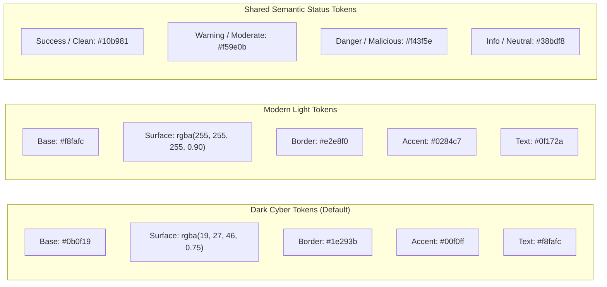
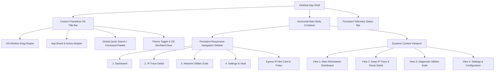
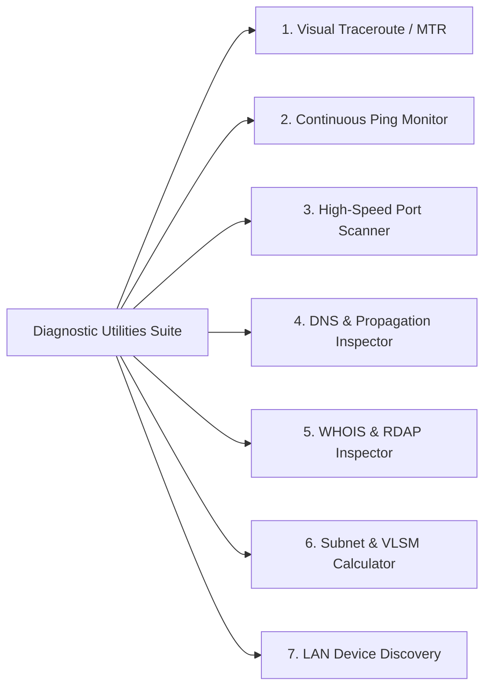

# IPTracer Standalone Application — User Interface Specification

**Document Version:** 1.0.0  
**Target Platform:** Cross-Platform Desktop (Windows 10/11, macOS 12+, Linux x64/ARM64)  
**Status:** Approved UI/UX Design System Specification  
**Design Paradigm:** Cyber-Glassmorphic Tactical Workstation  
**Companion Mockup:** `docs/standalone_app/mockups/index.html`  
**Date:** November 2026  

---

## 1. Executive Summary & Design Philosophy

The **IPTracer Standalone Application** transitions IPTracer from a sandboxed browser extension into a high-performance, military-grade desktop network diagnostics suite. While browser extensions are constrained by web sandboxes (unable to craft raw packets, adjust TTL headers, or run continuous background monitors), the desktop workstation provides low-latency kernel socket telemetry, offline MaxMind GeoLite2 databases, and persistent system tray monitoring.

To complement this advanced technical foundation, the user interface follows a **Cyber-Glassmorphic Tactical Workstation** aesthetic. The design philosophy centers on four pillars:

1. **Zero-Latency Perception**: High-frequency telemetry (ping sparklines, hop-by-hop packet updates, port scan sweeps) streams directly to hardware-accelerated canvas and SVG viewports without blocking UI responsiveness.
2. **Tactical Information Density**: High data density designed for network engineers, sysadmins, and cybersecurity analysts, balanced with clear typographic hierarchy and translucent glass surfaces so users are never overwhelmed.
3. **Universal Cross-Platform Harmony**: Standardized custom window framing supporting frameless drag regions on Windows (WinUI 3/Mica style), macOS (traffic light integration), and Linux (GTK header bar alignment).
4. **Accessible Cyber Aesthetics**: Deep dark backgrounds (`#0b0f19`) accented by vivid luminescent signals (Cyan `#00f0ff`, Emerald `#10b981`, Amber `#f59e0b`, Rose `#f43f5e`), backed by a complete high-contrast Light Theme for bright office environments.

---

## 2. Design Tokens & Visual Architecture

### 2.1 Color Palette & Theme Tokens

The application provides dual-theme support (Dark Cyber by default, Modern Light as toggleable alternate) managed through standard CSS custom properties.



#### Detailed Token Definition Table

| Token Variable | Dark Theme Value | Light Theme Value | Usage Description |
|---|---|---|---|
| `--color-bg-app` | `#0b0f19` | `#f8fafc` | Application root viewport background |
| `--color-bg-sidebar` | `#080c14` | `#f1f5f9` | Primary navigation sidebar background |
| `--color-bg-card` | `rgba(19, 27, 46, 0.75)` | `rgba(255, 255, 255, 0.88)` | Floating glassmorphic cards and containers |
| `--color-bg-card-hover` | `rgba(30, 41, 59, 0.85)` | `rgba(241, 245, 249, 0.95)` | Interactive list items and card hover states |
| `--color-bg-input` | `rgba(15, 23, 42, 0.90)` | `#ffffff` | Text fields, selectors, and terminal blocks |
| `--color-border-subtle` | `rgba(255, 255, 255, 0.08)` | `rgba(0, 0, 0, 0.08)` | Structural dividers and card outlines |
| `--color-border-focus` | `#00f0ff` | `#0284c7` | Input focus rings and active navigation tab border |
| `--color-text-primary` | `#f8fafc` | `#0f172a` | Primary headlines, metric values, and table data |
| `--color-text-secondary` | `#94a3b8` | `#475569` | Subtitles, field labels, and secondary details |
| `--color-text-muted` | `#64748b` | `#94a3b8` | Timestamps, placeholders, and inactive icons |
| `--color-accent-cyan` | `#00f0ff` | `#0284c7` | Primary brand accent, glowing telemetry dots |
| `--color-accent-purple` | `#a855f7` | `#7c3aed` | Secondary accent, route lines, ASN badges |
| `--color-accent-blue` | `#3b82f6` | `#2563eb` | Secondary utilities, DNSSEC verification |
| `--color-status-success` | `#10b981` | `#059669` | RTT < 30ms, 0% loss, clean threat score, open port |
| `--color-status-warning` | `#f59e0b` | `#d97706` | RTT 30–100ms, low loss, medium threat, filtered port |
| `--color-status-danger` | `#f43f5e` | `#dc2626` | RTT > 100ms, high loss, critical threat, closed port |
| `--color-status-info` | `#38bdf8` | `#0284c7` | Informational callouts and protocol tags |

### 2.2 Elevation & Glassmorphism

Glassmorphic styling gives depth without cluttering the screen. Glass layers utilize hardware-accelerated CSS `backdrop-filter`.

- **Elevation Level 0 (Canvas Base)**: Flat application backdrop (`#0b0f19` / `#f8fafc`).
- **Elevation Level 1 (Card & Content Panels)**:
  - Backdrop Blur: `blur(16px)`
  - Background: `rgba(19, 27, 46, 0.75)` (Dark) / `rgba(255, 255, 255, 0.88)` (Light)
  - Border: `1px solid rgba(255, 255, 255, 0.08)`
  - Shadow: `0 4px 20px -2px rgba(0, 0, 0, 0.45)`
- **Elevation Level 2 (Floating Popovers, Menus, Modals)**:
  - Backdrop Blur: `blur(24px)`
  - Background: `rgba(15, 23, 42, 0.92)` (Dark) / `rgba(255, 255, 255, 0.98)` (Light)
  - Border: `1px solid rgba(0, 240, 255, 0.25)`
  - Shadow: `0 12px 36px -4px rgba(0, 0, 0, 0.65), 0 0 15px rgba(0, 240, 255, 0.15)`
- **Accent Glow Token**:
  - `--shadow-cyan-glow`: `0 0 15px rgba(0, 240, 255, 0.35)`
  - `--shadow-purple-glow`: `0 0 15px rgba(168, 85, 247, 0.35)`
  - `--shadow-emerald-glow`: `0 0 12px rgba(16, 185, 129, 0.35)`

### 2.3 Typography Scale & Font Hierarchies

The typography stack utilizes two primary families:
1. **Primary Interface Font**: `Inter`, `-apple-system`, `BlinkMacSystemFont`, `"Segoe UI"`, `Roboto`, `sans-serif` — optimized for clean UI text, buttons, and titles.
2. **Monospace Network Telemetry Font**: `JetBrains Mono`, `"Fira Code"`, `Consolas`, `monospace` — utilized for IP addresses, CIDR notation, MAC addresses, hex dumps, latency measurements, and code blocks.

| Typographic Token | Size | Line Height | Weight | Letter Spacing | Font Family | Example Usage |
|---|---|---|---|---|---|---|
| `--font-display` | `32px` (`2.0rem`) | `1.2` | 700 (Bold) | `-0.02em` | Interface | Egress Hero IP Address |
| `--font-h1` | `24px` (`1.5rem`) | `1.3` | 600 (Semibold) | `-0.01em` | Interface | View Titles, Major Card Headers |
| `--font-h2` | `18px` (`1.125rem`) | `1.4` | 600 (Semibold) | `0` | Interface | Sub-panel Titles, Utility Names |
| `--font-h3` | `15px` (`0.9375rem`)| `1.4` | 600 (Semibold) | `0.01em` | Interface | Table Group Headers, Card Titles |
| `--font-body-lg` | `15px` (`0.9375rem`)| `1.5` | 400 (Regular) | `0` | Interface | Lead Paragraphs, Descriptions |
| `--font-body` | `13px` (`0.8125rem`)| `1.5` | 400 (Regular) | `0` | Interface | Standard UI Labels, Form Controls |
| `--font-mono-lg` | `16px` (`1.0rem`) | `1.4` | 600 (Semibold) | `0` | Monospace | Target Input Field, Latency Big Stat |
| `--font-mono` | `12px` (`0.75rem`) | `1.5` | 500 (Medium) | `0` | Monospace | IP Table Cells, Subnet Masks, MACs |
| `--font-micro` | `11px` (`0.6875rem`)| `1.3` | 600 (Semibold) | `0.04em` | Interface/Caps| Badges, Status Pills, Table Headers |
| `--font-nano` | `10px` (`0.625rem`)| `1.2` | 500 (Medium) | `0.02em` | Monospace | Graph Axis Labels, TTL Ticks |

### 2.4 Spacing & Grid System

Layout calculations follow a strict **4px baseline grid system**:

- `--space-1`: `4px`
- `--space-2`: `8px`
- `--space-3`: `12px`
- `--space-4`: `16px`
- `--space-5`: `20px`
- `--space-6`: `24px`
- `--space-8`: `32px`
- `--space-10`: `40px`
- `--space-12`: `48px`

#### Border Radius Tokens
- `--radius-xs`: `4px` (Tags, status badges)
- `--radius-sm`: `6px` (Buttons, small inputs)
- `--radius-md`: `8px` (Form controls, dropdown menus)
- `--radius-lg`: `12px` (Cards, panels, modal dialogs)
- `--radius-xl`: `16px` (Main application containers)
- `--radius-full`: `9999px` (Pills, circular avatar markers)

#### Responsive Breakpoints
- **Compact Viewport**: `< 880px` — Sidebar auto-collapses to icon rail; split views stack vertically.
- **Standard Desktop**: `880px – 1360px` — Persistent sidebar, side-by-side split panels, 4-column metrics grid.
- **Wide Workstation**: `> 1360px` — Extended map canvas, expanded data tables with all telemetry columns visible.

---

## 3. App Shell & Global Navigation Architecture

The desktop application shell provides consistent system framing, seamless multi-view transitions, and persistent status monitoring across all views.



### 3.1 Custom Window Title Bar
- **Height**: `40px`, non-scrolling, pinned to top.
- **Left**: Custom window icon, application name (`IPTracer Workstation`), version chip (`v1.0.0`), and active network interface badge (`Ethernet0 • 1 Gbps`).
- **Center**: Global Quick Search input (`Ctrl+K` / `Cmd+K`) accepting any IP, domain, ASN, or CIDR.
- **Right**:
  - Theme Toggle icon button (Sun/Moon switch with smooth 250ms CSS transition).
  - Native OS window controls (Minimize `_`, Maximize/Restore `□`, Close `✕`) with custom platform hover styling (Windows red close button, macOS traffic light styling when running on Darwin).

### 3.2 Persistent Responsive Sidebar
- **Width**: `240px` (Expanded) / `68px` (Collapsed Icon Rail).
- **Navigation Items**:
  1. **Dashboard** (`icon-dashboard`, label: "Dashboard", badge: "Live")
  2. **IP Trace Detail** (`icon-trace`, label: "IP Trace & Route", badge: null)
  3. **Network Utilities** (`icon-tool`, label: "Utilities Suite", badge: "7 Tools")
  4. **Settings** (`icon-settings`, label: "Configuration", badge: null)
- **Bottom Sidebar Anchor**: Egress IP quick widget displaying the current public IP (`104.28.19.42`), country flag (`🇺🇸`), live RTT pulse dot (`12ms`), and one-click copy button.

### 3.3 Dynamic Content Viewport
- **Transitions**: Views transition with a subtle `fade-scale` animation (`opacity: 0 -> 1`, `transform: translateY(4px) -> translateY(0)`, duration: `180ms`, easing: `cubic-bezier(0.16, 1, 0.3, 1)`).
- **Scroll Behavior**: Custom slim scrollbars (`width: 6px`, thumb color: `rgba(255, 255, 255, 0.15)`, track: transparent).

### 3.4 Persistent Telemetry Status Bar
- **Height**: `28px`, pinned to window bottom.
- **Telemetry Indicators**:
  - Left: Egress IP status (`Public IP: 104.28.19.42 • Cloudflare Inc (AS13335)`), Bogon Sentinel (`Clean`).
  - Center: DNS Health (`DoH Cloudflare • Latency: 4.8ms • DNSSEC Validated`).
  - Right: Memory / Socket load (`Sockets: 42 Active • Jitter: 0.8ms • MaxMind DB: v2026.11`).

---

## 4. View 1: Main Workstation Dashboard

The **Main Workstation Dashboard** delivers an immediate 360-degree situational overview of the user's local network, public egress identity, active outbound connections, and global network health.

```
+----------------------------------------------------------------------------------------------------+
| QUICK TRACE BAR: [ Enter domain, IP, ASN, or subnet (e.g., 8.8.8.8, github.com)...        ] [TRACE] |
+----------------------------------------------------------------------------------------------------+
| [PUBLIC EGRESS HERO]          | [LOCAL GATEWAY]           | [ACTIVE SOCKETS]         | [NET QUALITY]    |
| 104.28.19.42 [US 🇺🇸]         | 192.168.1.1               | 42 Established           | Grade: A+ (99.8%)|
| San Francisco, CA             | Interface: Ethernet0      | 8 Listening Inodes       | Latency: 12.4 ms |
| ISP: Cloudflare (AS13335)     | MAC: 00:1A:2B:3C:4D:5E    | Outbound Foreign: 18 IPs | Jitter: 1.1 ms   |
| [Clean • Threat Score 0%]     | Subnet: 255.255.255.0     | Top Remote: US / EU / JP | Packet Loss: 0.0%|
+-------------------------------+---------------------------+--------------------------+------------------+
| GLOBAL TOPOLOGY & SOCKET RADAR WIDGET (Interactive Canvas Map with active connection pins & arcs)  |
+----------------------------------------------------------------------------------------------------+
| RECENT ACTIVITY & TARGET STREAM                                                                     |
| Target            Resolved IP       Location              ISP / ASN           Latency   Threat   Action |
| 1.1.1.1           1.1.1.1           Los Angeles, US 🇺🇸     Cloudflare (AS13335) 8.4 ms   [Clean]  [Trace]|
| github.com        140.82.121.4      San Francisco, US 🇺🇸   GitHub / MSFT       14.2 ms  [Clean]  [Trace]|
| 185.220.101.5     185.220.101.5     Frankfurt, DE 🇩🇪       Tor Relay Node      112 ms   [High!]  [Trace]|
+----------------------------------------------------------------------------------------------------+
```

### 4.1 Component Specifications

#### 1. Universal Quick Trace Bar
- **Input Field**: High-contrast monospace font, placeholder with rotating presets (`8.8.8.8`, `github.com`, `1.1.1.1`, `AS15169`).
- **Quick Preset Badges**: One-click tags for `Google DNS`, `Cloudflare`, `Quad9`, `Local Gateway`.
- **Action**: Pressing Enter or clicking "Trace Target" immediately switches active tab to View 2 (IP Trace Detail) and initiates multi-hop route discovery.

#### 2. Egress IP Hero Card
- **Hero Display**: Displays current public IP in Display font (`32px`), adjacent to high-resolution country flag and copy button.
- **Animated Radar Ping Beacon**: Glowing radar ripple animation with pulsing cyan rings indicating active network heartbeat.
- **Geolocation Dossier**: City, Region, Country code, Postal code, Coordinates (`37.7749° N, 122.4194° W`), Timezone (`America/Los_Angeles UTC-8`).
- **ISP & ASN**: Organization name, BGP ASN badge with external PeeringDB lookup link.
- **Threat Indicator**: Radial badge showing AbuseIPDB confidence score (`0% Clean`, `Low Risk`).

#### 3. Real-Time Telemetry Grid (4 Cards)
1. **Public Egress Card**: Public IP, Country, City, ASN, Live Edge RTT.
2. **Local Gateway Card**: Default gateway IP, Local IP (`192.168.1.105`), MAC address, interface MTU (`1500`).
3. **Active Connections Card**: Established TCP sockets, listening ports, remote country distribution count.
4. **Network Quality Card**: Overall letter grade (`A+`), rolling RFC 3550 jitter calculation (`1.1ms`), packet loss percentage (`0.0%`).

#### 4. Interactive Global Topology / Socket Radar Widget
- **Visual Presentation**: Dark-mode world projection canvas displaying the host machine location with a glowing green beacon.
- **Active Sockets**: Curved lines radiate to foreign endpoints (Tokyo, Frankfurt, London, Singapore, New York) representing real active sockets.
- **Interactivity**: Hovering over any global pin displays a tooltip showing Remote IP, City, Organization, and Socket Count.

#### 5. Recent Activity Stream
- Sortable table of recent queries with status pills, latency tags, threat risk ratings, and quick actions ("Re-trace", "Export", "Delete").

---

## 5. View 2: Deep IP Trace & Route Detail View

The **IP Trace & Route Detail View** provides an in-depth forensic investigation of any queried destination, combining interactive route mapping, hop-by-hop latency tables, WHOIS ownership, and threat intelligence.

```
+----------------------------------------------------------------------------------------------------+
| TARGET BAR: [ Target: 8.8.8.8 (dns.google) ] [ Protocol: ICMP v ] [ Max Hops: 30 ]  [ RUN TRACE ]   |
+----------------------------------------------------------------------------------------------------+
| INTERACTIVE ROUTE MAP (60% Width)                 | FORENSIC DOSSIER & HOP METRICS (40% Width)     |
| [ Leaflet / MapLibre WebGL Canvas ]               | +--------------------------------------------+ |
|                                                   | | THREAT INTEL REPUTATION                    | |
|  (Local SF) ───[Hop 2]───[Hop 4]───(Denver)       | | [Radial Gauge: 0 / 100 Clean]              | |
|     |                                |            | | AbuseIPDB: 0 Reports • VT: 0/89 Engines    | |
|     +──────────[Hop 7]──────────────(Ashburn, VA) | | Tor Exit Node: NO • Datacenter ASN: YES    | |
|                                                   | +--------------------------------------------+ |
| Curved geodesic glowing route path with animated  | | NETWORK AUTHORITY & BGP ASN                | |
| packet pulses. Hover pins for latency & location. | | AS15169 Google LLC • ARIN Registry        | |
| Latency markers: Green <30ms, Amber, Red.         | | CIDR: 8.8.8.0/24 • Allocated: 1992-12-01   | |
|                                                   | +--------------------------------------------+ |
|                                                   | | ACTIONS: [Copy JSON] [Export CSV] [PCAP]   | |
+---------------------------------------------------+------------------------------------------------+
| HOP-BY-HOP TELEMETRY TABLE                                                                         |
| Hop  IP Address        Hostname / Reverse PTR    Carrier / ASN        Loss %   RTT Avg  Jitter Graph   |
| 1    192.168.1.1       router.local              Private Gateway      0.0%     1.2 ms   [ ▃   ]        |
| 2    10.120.0.1        gw-isp.sf.comcast.net     Comcast (AS7922)     0.0%     6.4 ms   [ ▄▃  ]        |
| 3    68.86.90.14       be-201-ar01.hayward.ca    Comcast (AS7922)     0.0%     9.1 ms   [ ▅▄  ]        |
| 4    142.250.238.16    *                         Google (AS15169)     0.0%     11.3 ms  [ ▆▅  ]        |
| 5    8.8.8.8           dns.google                Google (AS15169)     0.0%     12.1 ms  [ ▆▅  ]        |
+----------------------------------------------------------------------------------------------------+
```

### 5.1 Interactive Route Map Specifications
- **Map Engine**: Hardware-accelerated canvas/SVG vector map.
- **Geodesic Path Generator**: Plots great-circle curved arcs connecting hop nodes across continents.
- **Animated Pulse Particle**: A bright cyan photon travels along the polyline path at a speed proportional to measured hop latency.
- **Hop Marker Pins**:
  - Green (`#10b981`): Latency $< 30\text{ ms}$.
  - Amber (`#f59e0b`): Latency $30\text{ ms} – 100\text{ ms}$.
  - Rose (`#f43f5e`): Latency $> 100\text{ ms}$.
  - Gray Dashed (`#64748b`): RFC 1918 Private or Filtered Hop (`* * *`).

### 5.2 Hop-by-Hop Telemetry Table
- **Columns**:
  1. `Hop #`: TTL sequence index (1 to 30).
  2. `IP Address`: Target hop IPv4 or IPv6 with one-click copy icon.
  3. `Reverse DNS / PTR`: FQDN host string (e.g. `be-201-ar01.hayward.ca`).
  4. `Carrier / ASN`: BGP AS number and organization name.
  5. `Packet Loss`: Percentage loss over current probe cycle.
  6. `RTT Avg`: Round-trip time in milliseconds.
  7. `Jitter Sparkline`: Micro inline SVG bar chart showing variance over the last 5 packets.

### 5.3 Threat Reputation Dossier
- **Abuse Radial Gauge**: Scaled from 0 (Clean green) to 100 (Critical red).
- **AbuseIPDB Metadata**: Distinct reporter count, abuse category tags (e.g. SSH Brute Force, Web Attack).
- **VirusTotal Telemetry**: Malicious / Suspicious engine detection ratio (e.g. `0 / 89 engines flagged`).
- **Tor & Proxy Flags**: Tor exit node binary badge, VPN / Hosting datacenter detection badge.

---

## 6. View 3: Diagnostic Utilities Suite

The **Diagnostic Utilities Suite** organizes 7 specialized network engineering and forensic tools into an integrated, tabbed workspace.



### 6.1 Utility 1: Visual Traceroute & MTR
- **Controls**: Target input, Protocol selector (`ICMP Echo`, `UDP Datagram`, `TCP SYN`), Max Hops slider (`1–64`), Interval (`1.0s`), Start/Stop button.
- **MTR Mode**: Continuous multi-packet stream showing dynamically calculated Min, Avg, Max, Worst, and Standard Deviation RTT values per hop.
- **Export**: Generates full traceroute reports in JSON, CSV, and text traceroute format.

### 6.2 Utility 2: Continuous Ping & Network Quality Monitor
- **Controls**: Host input, Interval slider (`100ms – 2000ms`), Packet Size (`32 – 1472 bytes`), Don't Fragment (`DF`) toggle, Start/Pause/Reset buttons.
- **Real-Time Live Canvas Sparkline Chart**:
  - 60 FPS animated SVG/Canvas chart updating with every received Echo Reply.
  - Smooth Bézier curve with translucent gradient fill under the line.
  - Threshold line for average latency; red drop markers on timeout packets.
- **Statistical Telemetry Counters**:
  - Packets Sent, Packets Received, Packets Lost, Loss Percentage.
  - Min Latency, Avg Latency, Max Latency, Standard Deviation.
  - **RFC 3550 Real-Time Jitter Calculation**: Rolling statistical jitter update displayed in milliseconds.

### 6.3 Utility 3: High-Speed Port Scanner & Service Discovery
- **Controls**:
  - Target Host / IP input.
  - Port Range Presets: `Top 20 Ports`, `Top 100 Ports`, `Top 1000 Ports`, `Web Ports (80, 443, 8080, 8443)`, `Database Ports (1433, 1521, 3306, 5432, 6379, 27017)`, `Custom Range (1-65535)`.
  - Scan Technique: `TCP Connect` (unprivileged standard socket) or `SYN Stealth` (elevated raw socket).
  - Concurrency Slider: `50 – 500` parallel async workers.
- **Live Progress Visualizer**:
  - Progress bar with percentage completion, elapsed time counter, and current scan rate (`ports/sec`).
- **Discovered Ports Table**:
  - Port Number & Protocol (`80/tcp`, `443/tcp`, `22/tcp`).
  - State Badge: `OPEN` (emerald), `CLOSED` (rose), `FILTERED` (amber).
  - Service Name & Detected Banner (e.g. `nginx/1.24.0`, `OpenSSH 9.3p1`).
  - TLS / SSL Certificate Inspector: Subject, Issuer, Validity expiration date, and negotiated cipher suite.

### 6.4 Utility 4: DNS Inspector & Global Propagation Checker
- **Controls**: Domain input, Record Type selector (`ANY`, `A`, `AAAA`, `CNAME`, `MX`, `NS`, `TXT`, `SOA`, `SRV`, `CAA`), Protocol (`Standard UDP/53`, `DNS-over-HTTPS`, `DNS-over-TLS`), DNSSEC validation toggle.
- **Record Display Table**: Name, Type, TTL, Priority, Value / Target with formatted TXT string syntax highlighting.
- **DNSSEC Trust Chain Widget**: Visual verification badge showing `SECURE (Chain Validated to Root Trust Anchor)`.
- **Global Propagation Matrix**:
  - 8–30 regional vantage resolvers across 6 continents (North America, Europe, Asia-Pacific, Latin America, Africa, Oceania).
  - Real-time status badge per resolver (`MATCH`, `MISMATCH`, `TIMEOUT`), with round-trip latency and returned IP address.
  - Overall propagation gauge (e.g., `100% Propagated • 8/8 Resolvers Consistent`).

### 6.5 Utility 5: WHOIS & RDAP Registry Inspector
- **Controls**: Query field (Domain, IPv4, IPv6, or ASN), Protocol mode (`RDAP JSON` or `Legacy WHOIS Port 43`).
- **Structured RDAP Entity Cards**:
  - Registrar Information (Name, IANA ID, Abuse Contact Phone & Email).
  - Domain Status Codes (e.g. `clientTransferProhibited`, `active`).
  - Key Lifecycle Timestamps (Registered Date, Expiration Date, Last Updated Date).
  - Authoritative Nameservers array.
  - Raw WHOIS output collapsible drawer with syntax highlighting.

### 6.6 Utility 6: Subnet / CIDR & VLSM Calculator
- **Interactive Arithmetic Engine**:
  - Dual Input: IP Address text field (`192.168.10.45`) + CIDR prefix input / slider (`/24` or subnet mask dropdown `255.255.255.0`).
  - Calculates on every keystroke with zero latency:
    - **Network Address**: e.g., `192.168.10.0`
    - **Broadcast Address**: e.g., `192.168.10.255`
    - **Subnet Mask**: Decimal (`255.255.255.0`) & Full 32-bit Binary (`11111111.11111111.11111111.00000000`)
    - **Wildcard Mask**: e.g., `0.0.0.255`
    - **Usable Host Range**: e.g., `192.168.10.1` to `192.168.10.254`
    - **Total Address Count**: $2^{32 - \text{prefix}}$ (e.g. `256`)
    - **Usable Host Count**: $2^{32 - \text{prefix}} - 2$ (e.g. `254`) with RFC 3021 `/31` handling (2 usable hosts) and `/32` (1 host)
    - **IP Class & Scope**: Class A/B/C/D/E, RFC 1918 Private vs Public Unicast
- **VLSM Subnet Planner**:
  - Input parent CIDR block (e.g. `10.0.0.0/24`) and list of required host capacities (e.g. Engineering: 60, Sales: 25, Guest Wi-Fi: 12).
  - Automatically calculates optimal non-overlapping subnet allocations with a visual partition bar chart!

### 6.7 Utility 7: LAN Device Discovery & ARP Sweep
- **Controls**: Network Interface selector (`Ethernet0 192.168.1.0/24`), "Scan Local Network" button.
- **Scanning Engine**: Broadcasts ARP requests across local subnet and resolves device MAC addresses against embedded IEEE OUI vendor database.
- **Discovered Devices Table**:
  - Device Type Icon (Router / Gateway, Workstation, Laptop, Smartphone, Smart TV, NAS Storage).
  - IPv4 Address and Hostname (mDNS / NetBIOS / DNS PTR).
  - MAC Address with OUI Vendor Badge (e.g. `Apple, Inc.`, `Intel Corporate`, `Cisco Systems`).
  - Response Latency and Gateway indicator pill (`Default Gateway ⭐️`).

---

## 7. View 4: Settings & Configuration View

The **Settings & Configuration View** manages external API tokens, network adapter bindings, offline database updates, and UI behavior.

```
+----------------------------------------------------------------------------------------------------+
| SETTINGS & SYSTEM CONFIGURATION                                                     [SAVE CHANGES] |
+----------------------------------------------------------------------------------------------------+
| API KEYS & INTEGRATIONS VAULT                                                                      |
| AbuseIPDB API Key:    [ •••••••••••••••••••••••••••••••• ] [Eye] [Verify Key: Connected ✓]          |
| VirusTotal v3 Key:    [ •••••••••••••••••••••••••••••••• ] [Eye] [Verify Key: Connected ✓]          |
| IPInfo.io Token:      [ •••••••••••••••••••••••••••••••• ] [Eye] [Optional]                         |
+----------------------------------------------------------------------------------------------------+
| DNS & NETWORK ENGINE PREFERENCES                                                                   |
| Default DNS Provider: (o) Cloudflare DoH (1.1.1.1)  ( ) Google DoH (8.8.8.8)  ( ) System Native    |
| Custom DoH Endpoint:  [ https://cloudflare-dns.com/dns-query                                     ] |
| ICMP Probe Timeout:   [ 2000 ms ]               Max Traceroute Hops: [ 30 ]                        |
+----------------------------------------------------------------------------------------------------+
| OFFLINE GEOLOCATION DATABASE (MAXMIND GEOLITE2)                                                    |
| Database Status:      [ ACTIVE • GeoLite2 City (v2026.11.02) • 42.8 MB • Fast Memory Mapped ]      |
| Auto-Update:          [x] Download weekly database updates automatically                           |
| Actions:              [ CHECK FOR UPDATES NOW ]   [ MANUAL UPLOAD (.mmdb) ]                        |
+----------------------------------------------------------------------------------------------------+
| APPEARANCE & SYSTEM BEHAVIOR                                                                       |
| Application Theme:    (o) Dark Cyber (Default)   ( ) Modern Light    ( ) Follow OS System          |
| System Tray:          [x] Minimize to system tray on window close                                  |
| Watchdog Alerts:      [x] Trigger native desktop notification when public egress IP changes       |
| History Retention:    Keep last [ 500 ] traces in encrypted local SQLite database                  |
+----------------------------------------------------------------------------------------------------+
```

### 7.1 Sections Breakdown
1. **API Keys & Integrations Vault**: Securely saves third-party threat intelligence keys with password-masking toggles and instant connectivity test buttons.
2. **DNS & Network Engine Preferences**: Allows selection between encrypted DNS (Cloudflare, Google, Quad9) or system resolvers, with configurable socket probe timeouts and max TTL limits.
3. **Offline Geolocation Database Manager**: Displays current MaxMind database metadata, file size, last update timestamp, auto-update toggle, and manual file upload selector.
4. **Appearance & System Behavior**: Controls theme switching, background system tray daemon behavior, VPN egress IP change watchdog notifications, and local history limits.

---

## 8. State Transitions, Loading Skeletons, Error Handling & Empty States

### 8.1 State Transitions
- **Hover States**: Cards shift with subtle translation (`transform: translateY(-2px)`), border brightness increase (`border-color: rgba(0, 240, 255, 0.4)`), and shadow glow.
- **Button Active States**: Scale down (`transform: scale(0.97)`), ripple effect.
- **Tab Switching**: Active tab displays bright cyan indicator bar and background glow; inactive tabs remain muted slate.

### 8.2 Loading Skeletons
During asynchronous network operations (e.g. IP trace, port scan, DNS lookup), UI cards display shimmering loading skeletons rather than blank screens or generic spinners:
- **Skeleton Shimmer**: Linear gradient animation traversing from left to right (`linear-gradient(90deg, rgba(255,255,255,0.03) 0%, rgba(255,255,255,0.1) 50%, rgba(255,255,255,0.03) 100%)`, duration: `1.5s`, iteration: infinite).

### 8.3 Error Banners & Notifications
When socket errors, rate limits, or network timeouts occur:
- **Banner Layout**: Glassmorphic card bordered in `--color-status-danger` (`#f43f5e`), featuring an error badge, standard error code (e.g. `ERR_SOCKET_PRIVILEGE`), descriptive human-readable explanation, and actionable remediation button (e.g. "Restart as Administrator", "Switch to Online Failover").
- **Toast Notifications**: Slide in from top-right corner (`translateY(-20px) -> translateY(0)`), automatically dismiss after 4 seconds.

### 8.4 Empty States
- When history tables or port scan results are empty, centered illustrations with muted cyber icons and instructional callout text prompt the user to run their first test.

---

## 9. Accessibility (a11y), Contrast & Keyboard Navigation

### 9.1 Contrast & Readability
- All text meets **WCAG 2.1 AA** standards with minimum contrast ratio $\ge 4.5:1$ against glass surfaces. Primary text (`#f8fafc`) achieves $> 14:1$ contrast against the dark background (`#0b0f19`).
- Status indicators do not rely on color alone; every status badge pairs distinct color tokens with explicit text labels (e.g., `[● CLEAN]`, `[▲ MODERATE]`, `[✕ MALICIOUS]`).

### 9.2 Focus Management
- Interactive inputs, buttons, and links feature a high-visibility focus ring: `outline: 2px solid var(--color-accent-cyan); outline-offset: 2px`.
- Tab order follows standard logical reading flow across headers, sidebar, cards, and tables.

### 9.3 Global Keyboard Shortcuts

| Shortcut | Scope | Action Triggered |
|---|---|---|
| `Ctrl + K` / `Cmd + K` | Global | Focuses Global Search & Quick Trace input |
| `Ctrl + 1` / `Cmd + 1` | Global | Switches to View 1: Dashboard |
| `Ctrl + 2` / `Cmd + 2` | Global | Switches to View 2: IP Trace Detail |
| `Ctrl + 3` / `Cmd + 3` | Global | Switches to View 3: Diagnostic Utilities Suite |
| `Ctrl + 4` / `Cmd + 4` | Global | Switches to View 4: Settings & Configuration |
| `Ctrl + T` / `Cmd + T` | Global | Focuses Quick Trace input on current view |
| `Ctrl + R` / `Cmd + R` | Global | Refreshes current view telemetry and public IP |
| `Ctrl + Shift + T` | Global | Toggles Dark / Light visual theme |
| `Escape` | Global | Closes modals, dropdowns, or clears current search |

---

## 10. Summary & Handoff to Interactive Mockup

This specification serves as the design contract for the companion interactive mockup located in `docs/standalone_app/mockups/` (`index.html`, `styles.css`, `app.js`). All design tokens, elevation layers, component hierarchies, view layouts, and interactive behaviors specified herein are directly implemented in the functional prototype.
